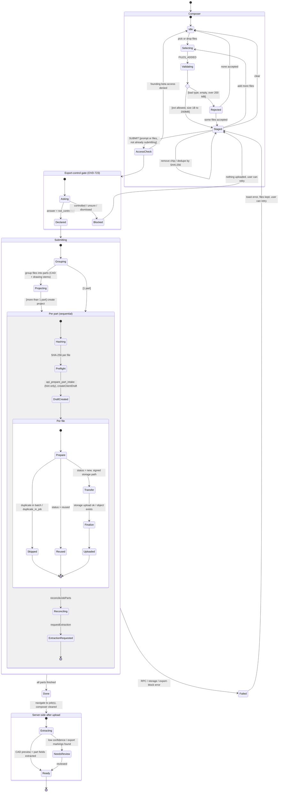

# Part upload statechart

Typical customer workflow for uploading a part model (CAD + optional drawing) and getting a draft job.
Derived from the current code, not a proposal:

- Client gating and selection: `src/components/chat/PromptComposer.tsx`, `src/features/quotes/file-validation.ts`
- Orchestration: `createJobsFromUploadFiles` / `uploadFilesToJob` in `src/features/quotes/api/uploads-api.ts`
- Export-control gate (OVD-723): `src/features/quotes/export-control.ts`

Notation: `[*]` start/end, `state { ... }` is a compound (nested) state, `--` separates parallel regions,
`<<choice>>` is a guard decision. Event names are on the arrows, `[guard]` is a condition.

## Notes on design choices

- **Gate before bytes.** The export-control answer is resolved before any hashing or transfer; the server repeats the check in the upload RPCs and storage policy, so the client gate is UX, not the control.
- **Client dedupe is a hint.** Same-`File` duplicates drop immediately; metadata never drops a file; a SHA-256 match removes a chip, and a failed digest keeps the file. The worker verifies bytes before assigning a canonical version.
- **Double-submit guard.** `submitGuardRef` blocks a second submit while the access refetch is pending, before `isSubmitting` renders.
- **Failure leaves a partial job.** A failure mid-loop keeps the already-created drafts and uploaded files; the diagram's `Failed → Staged` edge is the UI recovery, not a rollback. If you want transactional behaviour that is a separate decision.
- **Not modelled:** the signed-out redirect, the manual quote evidence upload path (`uploadManualQuoteEvidence`), and post-extraction quoting states.
