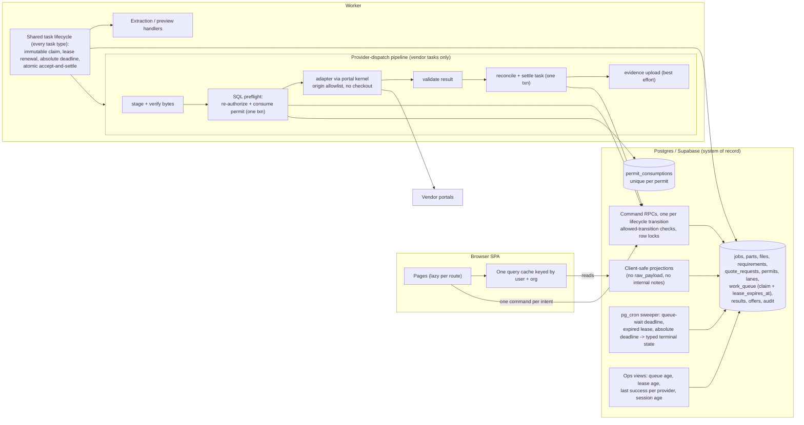
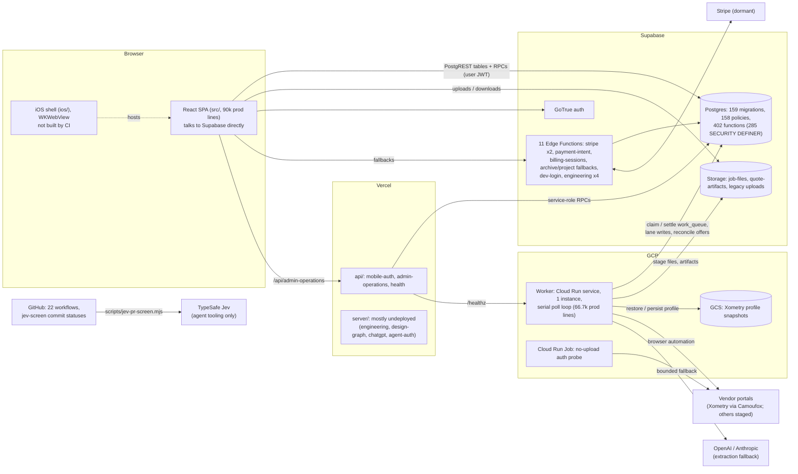

# OverDrafter architecture review and refactoring plan

- Date: 2026-10-23
- Source: `origin/main` at `6b613eab` (PR #915), reviewed in a clean worktree. The local `main` ref was a week stale (`d88d5df`, PR #833), so `origin/main` was fetched read-only.
- Status: final draft after two independent review rounds (GPT-6.1 Sol; both rounds returned *revise*). All round-2 findings were accepted and applied, but **the round-2 revisions have not been re-reviewed** (Q11). The review log is Appendix H.
- Jev decision log: [`architecture-refactor-2026-10-23.jev-log.jsonl`](architecture-refactor-2026-10-23.jev-log.jsonl)
- Progress (2026-10-24): S0.1 has shipped.
  - OVD-1062 (#918) caches the apt `.deb` files.
  - OVD-1063 (#919) splits vitest into three `unit` shards and `browser-test` into three lanes.
  - `main` is green again: run 40054865802 took 9 min 10 s, against a 19.7-minute median before, and every job is under 8 min.
  - The plan's other content is unchanged from the reviewed draft, apart from the five places where the 575 s Chromium step was first misattributed to a browser-cache miss; it was apt downloads.
  - Remaining Phase 0 decisions and the Q11 re-review are tracked in OVD-1073.
- Scope: analysis and planning only. No product code, PR, Linear or protected action is part of this document.

Every problem statement cites `file:line`, a doc section, a test, a git-history pattern or a measurement. Each is labelled **observed** (seen in code, data or a run) or **inferred** (a hypothesis, with the evidence that would settle it). Jev (TypeSafe `jev-1.13.0`) outputs are advisory. They can only raise a priority or risk tier, and they are never cited as evidence.

## 1. Executive summary

1. **Main is not green.** The last three pushes to `main`, including the reviewed head, were cancelled when the CI `test` job hit its 20-minute cap (`.github/workflows/ci.yml:70`; runs 39925317359, 39890186772, 39885473418). Passing test jobs take a median of about 16.8 minutes. On the head run, setup alone took about 19.5 minutes, dominated by apt downloads from the Ubuntu mirror at 45.6 kB/s: 575 s for the system packages behind `playwright install --with-deps chromium` (the browser cache itself hit) and 223 s for the OCR packages. The step-zero fix is CI headroom, mostly in setup. (Corrected 2026-10-23 after reading the step logs; OVD-1062 and OVD-1063 implement it.)
2. **Lifecycle state has no single owner.** Job, run, lane and task status are written by 47 worker call sites, 15+ RPCs, a trigger and staff RLS policies, with no SQL transition guard. Late writers can regress settled state: `worker/src/index.ts:463-552`, `supabase/migrations/20261002182714_free_quote_job_meter.sql:505-516`.
3. **Termination is not bounded.** Task claims have no lease or heartbeat, and completion is not fenced (`worker/src/queue.ts:79-123, 204-231`). Reaping runs only inside the worker (no `pg_cron`). Lanes other than free-beta Xometry are never settled when their task is reaped. The client polls for ever (`src/features/quotes/client-workspace-polling.ts:21-60`).
4. **Dispatch safety partly lives in process memory.**
   - Permit single use for generic providers is an in-memory `Map` (`worker/src/providerExecutionSeam.ts:91-101`). The Xometry route has no consumer (`worker/src/index.ts:1820` is the only use); in-process retries after an upload are prevented separately by a mutation phase (`vendorTaskRetry.ts:86-88`).
   - The day switch, fixture-heal pause and daily cap reset on restart, and the cap fails open.
5. **The production lane takes the less-guarded path.** Xometry bypasses the generic pipeline and its result validator (`worker/src/index.ts:1931`; the generic pipeline rejects Xometry at `providerTaskPipeline.ts:561`). It has no adapter-start cap and can discard a captured quote when evidence or snapshot writes fail.
6. **Security edges are open:**
   - A pull-request CI job runs PR code with the service-role and model keys (`.github/workflows/ci.yml:365-384`).
   - The required `ci` check is defined in PR-controlled YAML. Workflow edits need Blaine's approval, but the check itself is not trusted.
   - Sign-out never revokes the server session (`src/hooks/use-app-session.ts:671-680`).
   - Customers receive raw vendor diagnostics through the quote RPC (`20260816015500_…:126`).
   - Export-control legacy upload paths stay ungated until an unapplied contract migration.
7. **Too many mechanisms for one idea.** There are two dispatch stacks, six or more retry owners, seven off-switches with conflicting defaults, three adapter frameworks, three Jev clients and 426 function redefinitions across 159 migrations.
8. **The repository carries the process and the history as well as the product.** It has 22 CI workflows, about 10 of them report-only. The sensitive-path list grew from 53 to 162 globs in five days and now matches 45% of files, so 35 of the 37 live roadmap steps below need Blaine's approval. There are 439 per-issue files, and the docs contradict the code in 10+ places.
9. **Users pay in latency.** The part page issues about 25 requests over 9 serial round trips and polls them every 5 seconds. A 495 KB-gzip App chunk loads before any data. A 7.6 MB WASM parses the STEP file on the main thread by default.
10. **Target shape.** The incremental path (Section 4) gets there without a rewrite:
    - one database-owned state machine per lifecycle;
    - one shared task lifecycle (claim identity, lease, deadlines, atomic accept-and-settle) under a database sweeper;
    - atomic authorize-and-consume of permits;
    - one provider-dispatch pipeline that Xometry joins through a compatibility contract after OVD-206;
    - server-side intent commands;
    - a narrow approval tier for governance.

## 2. Target architecture

### Invariants the target guarantees

| ID | Invariant | Enforced by | Today |
|---|---|---|---|
| I1 | Every quote request, lane and task reaches a typed terminal state within a bounded time, even if no worker is alive. Three deadlines apply: queue-wait (no worker claimed it), lease expiry (the worker stopped renewing), and absolute (renewing but stuck). | `pg_cron` sweeper (S1.4); worker watchdog and terminable CAD thread (S1.7); replayable lane settlement (S1.3) | Not enforced (F01, F02) |
| I2 | At most one provider interaction per permit, across processes and restarts. | Both preflights re-authorize against the exact claim and scope and consume the permit in one transaction, after staging (S2.1) | Generic route: process memory. Xometry: no consumer; in-process post-upload retries are blocked by the mutation phase (F04). |
| I3 | Each lifecycle column has one writer: SQL command functions with allowed transitions and one lock order. Exceptions are inventoried and justified. | S1.1b, S1.1c, S1.3, S2.2, S2.4 (writer inventory incl. `quote_runs`, append-only audit) | 47 worker sites, 15+ RPCs, trigger, staff RLS (F03) |
| I4 | Offers become visible only through validate-then-reconcile. | S3.1, S3.2, S2.4 | Validator skipped on Xometry; importers and staff RLS bypass it (F05, F11) |
| I5 | No fallback changes behavior without a typed, operator-visible event. | S1.6, S1.8, S2.3 | 163 catch-and-default blocks in adapters; fail-open caps (F06, F10) |
| I6 | Authorization is decided in SQL at each action boundary; no TypeScript re-implementation with a superuser connection. | S4.4, S4.5 | Archive and create-project fallbacks (F15) |
| I7 | One source of truth per concept: provider list, retry policy, off-switch, Jev client, env defaults. | S3.2, S7.5, S7.4 | Two to seven copies each (F23–F25, F29, F31, F38) |
| I8 | Code outside the 1.0 promise cannot execute on the 1.0 path. | S5.1–S5.4 | Inert Jev hooks threaded through dispatch (F26) |
| I9 | Customers receive only client-safe projections. | S4.2 | Raw vendor payloads returned (F16) |
| I10 | `main` is green; the required checks are *executed* by a workflow the PR cannot change, and PR-controlled execution helpers need approval. | S0.1, S0.3; residual limit in Q10 | Cancelled at head; PR-defined aggregate (F21, F17) |

### Why incremental migration, not a rewrite

A rewrite was considered for three units:
- the worker loop (`worker/src/index.ts`, 2,873 lines);
- the Xometry adapter (`worker/src/adapters/xometry.ts`, 3,868 lines);
- the queue, by adopting a Postgres job library such as pg-boss or Supabase Queues (pgmq) that provides leases, retries and cron.

Each loses to incremental migration:
- **Qualification.** The OVD-419 and OVD-206 release gates bind evidence to an exact worker image and a governed session contract (`PLAN.md` items 4–5). Any rewrite of the dispatch path resets that qualification, which delays the 1.0 critical path.
- **Coupling.** Permits, preflights and lane identity reference `work_queue` rows and `attempts` directly (`20261003170000_ovd459_provider_dispatch_preflight.sql`; `worker/src/providerTaskPipeline.ts:111-121`). A queue swap touches every one of those contracts at once.
- **Cost.** The missing invariants are additive: one lease column, one consumption table, one reconcile signature extension and one sweeper function. The review showed they need careful transaction and lock design (S1.1b, S1.2, S2.1, S2.2), but not a new queue.

Revisit a queue library only if the worker needs more than one concurrent consumer after 1.0.

## 3. Ranked findings

**Columns:**
- **Final** is the higher of my tier and Jev's tier (Jev p(incident) ≥ 0.6 maps to high, ≥ 0.4 to medium; p(silent) ≥ 0.7 raises to at least medium). A ↑ marks a tier Jev raised.
- **Effort:** S is ≤ 1 day, M is ≤ 1 week, L is more than that.
- **Fix risk** is the risk of making the change.
- **O/I** means observed or inferred.
- **P(inc)** is Jev's probability that the finding causes a production incident within 6 months. **P(silent)** is Jev's probability that it is a silent-failure path. Both come from Jev use #2 under a stated pre-launch deployment context. They are advisory, and the band is compressed (0.25–0.78; see Section 9).

| # | ID | Axis | Finding | Key evidence | O/I | Final | Effort | Fix risk | Conf. | P(inc) | P(silent) |
|---|---|---|---|---|---|---|---|---|---|---|---|
| 1 | F21 | Reliability | Main is not green: the test job exceeds its 20-minute cap; 3/3 latest main pushes were cancelled | `ci.yml:70`; runs 39925317359, 39890186772, 39885473418; passing test jobs 12.8–18.9 min | O | high | S | risky (CI) | high | 0.49 | 0.15 |
| 2 | F17 | Security | A PR CI job runs PR-head code with the service-role key and three model keys in its env (same-repo PR branches receive secrets; fork PRs do not). The required `ci` aggregate is defined in PR-controlled YAML. Workflow and CI-script edits need Blaine's approval, so this is a backstop, not a trusted check. | `ci.yml:365-384`, `ci.yml:589-675` | O | high | S | risky | high | 0.57 | 0.72 |
| 3 | F01 | Reliability | Task claims have no lease, heartbeat or attempts ceiling. Completion is not fenced, so a reaped task can be flipped back to completed and still persist offers. Each new process reaps at startup (deploy overlap). Reaped lanes stay non-terminal except free-beta Xometry. | `queue.ts:79-123, 204-231`; `20260324120000_add_api_claim_next_task.sql:13-34`; `index.ts:2775-2794`; `20261003011148_…:39-48` | O (race interleaving inferred) | high | S–M | risky | high | 0.71 | 0.59 |
| ~~3a~~ | ~~F42~~ | — | **Withdrawn after review R2-02.** I claimed an unexpected post-upload Xometry error is retried under the same permit. That is false. `markProviderMutationStarted()` runs before each upload (`adapters/xometry.ts:1806-1807, 2508-2509`). The task runs inside `runInProviderMutationPhase` (`index.ts:2540-2542`), and `isRetryableVendorTaskError` refuses retry once the phase has started (`vendorTaskRetry.ts:86-88`), as tested at `xometry.test.ts:6870-6889`. I had read only the payload check. | — | — | — | — | — | — | (0.61 from a false premise) | — |
| 4 | F02 | Reliability | No DB-enforced termination: no `pg_cron`; reaper, kill-switch sweep and reconciliation run only in the worker loop after readiness; the client polls queued/requesting for ever | `index.ts:2779-2836`; no `cron`/`pg_net` in `supabase/migrations`; `client-workspace-polling.ts:21-60` | O | high | M | risky | high | 0.67 | 0.79 |
| 5 | F03 | Reliability | Lifecycle status is unowned. Unchecked job/run UPDATEs have no precondition; reconcile overwrites settled lanes; cancel neither stops running tasks nor fences non-free reconciles; the request trigger can lose updates under concurrent lane completion. | `index.ts:463-552` (499-511); `20261002182714_…:478-516, 754-790`; `20260331000000_…:31-110` | O (trigger race inferred) | high | M–L | risky | high | 0.62 | 0.65 |
| 6 | F07 | Reliability | One Xometry session failure nulls the process-wide snapshot generation until restart while `/ready` stays 200. A captured quote is discarded if snapshot persistence or artifact upload fails, because both run before the atomic result write. | `adapters/xometry.ts:2985-2997, 3802-3858`; `index.ts:1968-2009`; `files.ts:88-115` | O | high | M | risky | high | 0.78 | 0.67 |
| 7 | F05 | Reliability | The production Xometry route bypasses `validateProviderResult`; only the generic pipeline calls it. The module contract says every result must pass it. ARCHITECTURE.md:168 correctly scopes the wiring to the generic route (corrected after review R1-18/spot-check 18). | `index.ts:1931` ("Xometry bypasses runProviderTaskPipeline"); `providerTaskPipeline.ts:989`; `providerResultValidation.ts:4-5` | O | high | M | risky | high | 0.57 | 0.50 |
| 8 | F14 | Security | The export-control expand/contract migration is half done: legacy 6/8-arg upload RPCs and old workers are ungated; SQL preflights don't check export control. The Xometry permit stores no file hashes, and the disclosed file list lives in cascade-deletable lane rows. | `20261013043000_ovd723_…:14-40`; `20260815100000_add_xometry_beta_dispatch_permits.sql:13-57` | O | high | M | risky | high | 0.55 | 0.59 |
| 9 | F08 | Reliability | Serial FIFO worker. No whole-task deadline, no timeout on hot DB calls, synchronous STEP tessellation, `/health` 200 when stuck; on SIGTERM the in-flight task outlives the grace period. | `index.ts:2779-2850`; `httpServer.ts:302-358`; `queue.ts:51-53`; `cadPreview.ts:64-69`; `index.ts:2674-2693` | O / I (platform grace) | high | M | normal | med-high | 0.75 | 0.73 |
| 10 | F19 | Operations | No SPA error telemetry; Vercel functions barely log; Xometry session age is file mtime (rewritten by every restore); admin projection hard-codes drifted provider and failure-code lists | `src/lib/diagnostics.ts:106,422`; `server/admin-operations/projection.ts:16-22, 57-79`; `httpServer.ts:24-50` | O | high ↑ | M | normal | high | 0.76 | 0.89 |
| 11 | F06 | Reliability | Swallowed lane writes on the legacy route: `.catch(() => "written")`, unchecked running/spend-cap/adapter-not-enabled writes; a failed requeue leaves the lane running | `index.ts:1522-1539, 1324-1339, 1596-1616, 1649-1679` | O | high ↑ | S | normal | high | 0.67 | 0.82 |
| 12 | F13 | Security | Sign-out deletes the stored session before `signOut({scope:"global"})`, so auth-js never calls logout and refresh tokens stay valid. A timed-out user check is promoted to authenticated. Session restore has 13+ fix commits since March. | `use-app-session.ts:671-680`; `@supabase/auth-js` 2.77.0 `GoTrueClient.js:1112, 1496-1520`; `startup-auth.ts:382-429` returns `session_error`, promoted downstream in `session-api.ts:205-244`; git history | O | high ↑ | S (order) / M (layer) | risky (auth) | high | 0.64 | 0.64 |
| 13 | F12 | Reliability | The browser orchestrates intake (prepare, upload, finalize, reconcile, extract) and optional fan-out without a server transaction; an interrupted tab strands a part that then polls for ever; no interruption test | `api/uploads-api.ts:211-387`; `provider-fanout.ts:281-312`; `e2e/intake.spec.ts` | O | high ↑ | M | risky | high | 0.69 | 0.69 |
| 14 | F20 | Reliability | 10 files in `supabase/migrations` carry frozen draft headers ("NOT APPLIED") because promotion copies drafts in byte-for-byte (`20261012212325_…:3-5`) and migrations are immutable. These headers are **not** deployment state: e.g. `5773decb` (PR #717) records 20261012212325 as applied. The cost is reader confusion, not a deployment gap (corrected after review R1-18). The worker calls an RPC that exists only in `docs/migration-drafts` on every live dispatch; flags call 3+ unmigrated RPCs; 68 DEFINER functions pin a public-first `search_path` | `20261012212325_ovd462_…:1-7`; `providerSettings.ts:369-371, 560-584`; `provider-fanout.ts:17-23` (flag) and `use-provider-fanout.ts:36-39` (RPC call); `scripts/lint-security-definer.mjs:73` | O | high ↑ | M | normal | high | 0.72 | 0.46 |
| 15 | F11 | Reliability | Offers can be written outside validate-then-reconcile (two importer tools; staff `FOR ALL` RLS on offers, results, work_queue, audit); the stale-offer delete silently clears a customer selection | `20260303101500_…:749,764,841,856`; `worker/src/tools/importSpreadsheetQuotes.ts`; `20261002182714_…:610-616` | O | high ↑ | M | risky | high | 0.62 | 0.63 |
| 16 | F10 | Reliability | The daily dispatch cap is uncapped when its (unmigrated) RPC fails, on every live dispatch; a spend-ledger outage is reported to the lane as "Spend cap reached" | `providerSettings.ts:560-584, 618-663`; `spendGuard.ts:103-109`; `index.ts:1642-1688` | O | high ↑ | S–M | risky | high | 0.76 | 0.45 |
| 17 | F18 | Security | No CSP or frame headers on the SPA while tokens are in localStorage; `?debug=1` in production enables diagnostics exposing email, org, role and mutation variables | `vercel.json` (no `headers`); `DiagnosticsBootstrap.tsx:18-50` | O | high ↑ | S | normal | high | 0.60 | 0.62 |
| 18 | F39 | Reliability | Some client data outlives its session: browser-local per-job data (quote reference, excluded vendors) is keyed by job only and survives sign-out; the active org is always `memberships[0]`; home auto-creates an org for any verified user with no membership. *(Narrowed after review R2-08: workspace query keys already include user, org and role, with 30–45 s stale times, `workspace-navigation.ts:12-32`.)* | `quote-local-reference.ts:10-40`; `use-app-session.ts:570`; `use-client-home-controller.ts:196-238` | O | high ↑ | M | normal | medium | 0.64 | 0.74 |
| 19 | F22 | Reliability | Tests miss the paths that fail: no test runs `main()`; reaper race, Xometry route on real DB, reconcile-vs-cancel and concurrent lane completion are untested in CI; 43 test files assert migration SQL as text (687 assertions) | `worker/src/queue.test.ts:182-251`; `scripts/qualification/free-quote-meter-concurrency.sql` (manual); `src/features/quotes/*-migration.test.ts` | O | high ↑ | M | low | high | 0.66 | 0.51 |
| 20 | F23 | Simplicity | Two dispatch stacks (permit tables, request RPCs, preflights with different retry semantics, worker routes, persistence, kill-switch writers, fixture gate) plus an unreachable third wrapper | `xometryDispatchPreflight.ts:104-160`; `providerDispatchPreflight.ts:186-337`; `dispatchRouting.ts:143-199`; `providerTaskPipeline.ts:1028-1113` | O | high | L | risky | high | 0.46 | 0.41 |
| 21 | F33 | Speed | CI: `ci.yml` p50 17.1 min, p90 21.4 min (n=100); vitest step 634 s; test job serialized behind OVD-591 qualification; 85–96 s dependency install per job; about 190 script test files (incl. per-issue release scripts) in every PR | `gh run list` 2026-10-21..23; `ci.yml:65-70`; `vite.config.ts:123-132` | O | high | S | risky (CI) | high | 0.31 | 0.15 |
| 22 | F35 | Speed | Part detail is about 25 requests over 9 serial trips, polled every 5 s (about 312 requests/min/tab); `/quotes/:code` downloads every job to hash ids (12+ serial trips); prefetch adds up to 161; refocus about 55 | `workspace-api.ts:607-671`; `jobs-api.ts:512-527`; `ClientQuoteDetail.tsx:85-125`; `use-client-workspace-data.ts:44-273` | O | high | M | risky | high | 0.44 | 0.46 |
| 23 | F04 | Reliability | Permit single use is an in-memory `Map` on the generic route only. The production Xometry route has no consumer at all (`index.ts:1820` is the only use). SQL preflights are read-only; permits carry no consumed state. | `providerExecutionSeam.ts:91-101`; `index.ts:164, 1820`; `ARCHITECTURE.md:510-537` | O | medium (raised in round 1, restored after R2-02) | M | risky | high | 0.44 | 0.71 |
| 24 | F16 | Security | `api_list_client_quote_workspace` returns full `vendor_quote_results` rows to customers, including `raw_payload` (vendor page `bodyExcerpt`, artifact paths, URLs, adapter error payload) | `20260816015500_…:126-131`; `index.ts:355-372, 1522-1536` | O | medium | S–M | risky | high | 0.44 | 0.25 |
| 25 | F15 | Security | Two Edge fallbacks bypass SQL commands with direct DB connections. The archive fallback re-implements edit authorization more broadly than SQL and deletes storage before the DB delete commits. The create-project fallback creates projects and memberships without the canonical `project.created` audit event (added after review R2-10). Neither matches any sensitive glob. | `supabase/functions/job-archive-fallback/index.ts:136-230, 430-487`; `archive-api.ts:354-356, 646-647`; `supabase/functions/create-project-fallback/index.ts:27-35, 110-159` | O | medium | M | risky | high | 0.49 | 0.49 |
| 26 | F09 | Reliability | The stable-egress profile deploys a poll-only worker as a scale-to-zero Cloud Run service with no wake mechanism | `deploy-cloud-run.sh:208-209, 381-394`; `docs/workflows/ovd410-stable-egress.md:157` | I (settle with Cloud Run instance-count metrics over an idle hour) | medium | S | risky (deploy) | low | 0.48 | 0.71 |
| 27 | F38 | Reliability | Domain rules hand-mirrored: provider jurisdiction in three places with different "unknown" semantics (export-control adjacent); scoring and pricing curves twice; 8 constants copied across runtimes | `provider-fanout.ts:40-85`; `worker/src/exportControl.ts:50-71`; `src/features/operations/contract.ts:8-11` | O | medium | M | normal | high | 0.59 | 0.67 |
| 28 | F25 | Simplicity | Seven off-switches with conflicting missing-row defaults; four cost and rate guards; a global advisory lock serializes every spend reservation | `20260731010001_…:26,167-181`; `20261013043100_ovd722_…:60-163` | O | medium | M | risky | high | 0.52 | 0.54 |
| 29 | F24 | Simplicity | Six or more retry owners; the legacy route has no adapter-start cap | `vendorTaskRetry.ts:16, 82-175`; `index.ts:1456-1483, 2557-2568`; `providerTaskPipeline.ts:200-276` | O | medium | M | risky | high | 0.45 | 0.50 |
| 30 | F26 | Simplicity | Non-1.0 code on the 1.0 path: 2,768 production lines (6,555 with tests) of Jev, recovery and quote-intelligence code threaded through `main`, the adapter registry, the Xometry adapter and the kernel but never enabled (`main()` is called with no host). Also 24 unreachable worker modules (3.1k lines), undeployed server trees, dead frontend components, a deployed but unused mobile-auth bridge, and iOS unbuilt by CI. | `index.ts:2499-2521, 2628, 2855`; `adapters/index.ts:186-235`; `tools/compareBrowserRecovery.ts:10` | O | medium | M | risky | high | 0.41 | 0.46 |
| 31 | F28 | Simplicity / Speed | 22 workflows (20 since late September), about 10 report-only; sensitive list 53 → 162 globs in five days, matching 45.0% of files; 439 per-issue files (14.5%); 35 of 37 roadmap steps need Blaine's approval; two superuser-connection Edge Functions match no glob | `docs/sensitive-paths.json` history (`75662898`..`c42ac085`); matcher run; Section 4 table | O | medium | M | risky (gate loosening) | high | 0.45 | 0.36 |
| 32 | F29 | Simplicity | Docs and config disagree with code: 10+ ARCHITECTURE.md as-built contradictions; REPO_MAP misses four roots; worker defaults in 4 places disagree on 5 settings; 48 of 110 env vars undocumented; CHANGELOG last entry 2026-05-05 | `ARCHITECTURE.md:168, 342-348, 391-394, 476-478`; `worker/src/config.ts:51-87` vs `deploy-cloud-run.sh:29-304` | O | medium | S–M | low | high | 0.56 | 0.51 |
| 33 | F27 | Simplicity | Function evolution by full-body copy and text patching: 426 `CREATE OR REPLACE FUNCTION` statements (anchored count, corrected in review) across 159 migrations, `api_request_quote` ×10, four `pg_get_functiondef` patches, and a restore migration because replaying older migrations overwrote newer definitions. Historical revisions are not active duplicate implementations (corrected after review R1-20); the cost is the editing technique and its replay hazard. | `20260816015500_…:1-7`; migration grep | O | medium | L | risky | medium | 0.49 | 0.59 |
| 34 | F30 | Simplicity | Three adapter frameworks (bespoke Xometry/Fictiv, portal kernel, HTTP); 163 catch-and-default blocks (77 in `xometry.ts`) | `adapters/xometry.ts`; `providerPortalKernel.ts:2027`; `portalWorkflow.ts:245` | O | medium | L | risky | high | 0.50 | 0.55 |
| 35 | F34 | Speed | 495 KB-gzip App chunk with all 23 pages loads serially after `main.js`; part page loads 7.6 MB OCCT WASM and parses STEP on the main thread by default despite a server preview | `src/App.tsx:21-58`; `main.tsx:11`; `ClientArtifactWorkspace.tsx:21-71`; local `vite build` | O | medium | M | low | high | 0.48 | 0.55 |
| 36 | F36 | Speed | Unscoped `jobs`/`projects` selects evaluate per-row `SECURITY DEFINER` helper chains across all tenants; `is_platform_admin()` not wrapped; 6 hot filter columns unindexed | `jobs-api.ts:426-433`; `20260304010000_…:155-242`; `20260325120000_…:39-43` | I (settle with EXPLAIN on staging) | medium | M | risky | medium | 0.41 | 0.54 |
| 37 | F37 | Speed | Developer loop: half the tree routes to the heaviest review and Blaine's approval; PR median grew to 403 lines after the 200-line guideline; no `.gitattributes`, so a Windows checkout fails 529 tests | history; matcher; local run | O | medium | S | normal | high | 0.40 | 0.31 |
| 38 | F41 | Reliability | Five environment-identity mechanisms; the Dockerfile sets `NODE_ENV=production` and the deploy script sets no staging marker, so a staging worker likely identifies as production | `worker/src/runtimeEnvironment.ts:3-26`; `worker/Dockerfile:20`; `index.ts:1775` | I (check a staging worker's lease environment) | medium | S | normal | low-med | 0.43 | 0.50 |
| 39 | F40 | Security | Dispatch affirmations are literal `true` in the API layer; the user's checkboxes only enable the button | `src/features/quotes/api/quote-requests-api.ts:142-154` | O | medium ↑ | S | normal | high | 0.41 | 0.65 |
| 40 | F32 | Simplicity | Two Stripe stacks; the legacy webhook carries a TODO to enqueue Xometry order placement (default-off); billing functions call undefined RPCs | `supabase/functions/stripe-webhook/index.ts:107-117`; `billing-sessions/index.ts:701-712` | O | low | S | risky (payments) | high | 0.39 | 0.59 |
| 41 | F31 | Simplicity (Jev) | Three Jev clients; the PR screen (946 lines with a commit-status cache) raised 5 of 41 tiers, and nothing in the repo consumes its result; its log moved outside the repository. See Section 9. | `scripts/jev-client.mjs`; `worker/src/jev/choice.ts:41-90`; `server/engineering/sample-plate-adapter.ts:36-45`; `git show 066161de^:docs/agent-log/jev-decisions.jsonl` | O | low | S | normal | high | 0.25 | 0.45 |

**Repeat-offender areas (git history, observed):**
- Session restore: 13 fix-worded commits on `src/hooks/use-app-session.ts` and 7 on `session-api.ts`, from 2026-03-19 to 2026-10-21.
- Part page: 21 fixes on `use-client-part-controller.ts` and 19 on `ClientPart.tsx`.
- Xometry portal drift: 45 commits on `xometry.ts`, and 51 subjects mention Xometry.
- Archive/delete: 6 fixes in March, and `api_delete_archived_jobs` was defined 4 times.

Process versus product churn over the last 30 days: `scripts/` had 189 commits and 101k lines; `docs/` had 168 commits; `src/` had 77; `worker/` had 86. 164 of 353 commits touched no product path.

## 4. Phased roadmap

Revised after independent review rounds 1 and 2 (Appendix H). † means the step was rewritten after round 1; ‡ means it was rewritten or added after round 2. Round-2 revisions have **not** been re-reviewed (Q11). Every migration step also updates the CI migration pins (`scripts/free-quote-ci-profile.mjs`, `scripts/fixtures/free-quote-ci-source.json`) per review R2-07, which makes each one `infra_ci`-sensitive.

**Rules for every step:**
- One PR of about 200 lines or less; behavior changes behind a default-off flag where noted.
- Rollback is a `git revert` of the squash commit unless stated otherwise.
- `main` stays green, which first requires Phase 0.
- Migrations follow the staging-first runbook and need Blaine's approval card for the production apply.

**Release impact.** Any change under `worker/src` changes the worker image (`worker/Dockerfile:11`).
- Source can merge independently.
- *Deployment* of a worker change inherits no qualification evidence. It must go through a deliberately requalified OVD-419 bundle (`PLAN.md` items 4–5), never between qualification and the OVD-206 live runs.

**Tier columns:**
- *Sensitive* is `scripts/lib/sensitive-paths.mjs` `classifyPaths` over the listed files at `6b613ea`.
- *Det.* is `risky` on any match; otherwise it is my own tier.
- *Jev* is the Jev `choice` (use #3; round-1 revisions re-asked). Below 0.5 confidence it is recorded and floored at `normal`, never trusted.
- *Final* is max(Det., Jev effective).
- *Approval* follows the AGENTS.md auto-merge categories: 35 of 37 live steps need Blaine.

### Phase 0: green, trustworthy `main` (do first)

| Step | Scope | Files | Rollback | Verification | Sensitive | Det. | Jev | Final | Approval | Release impact | Depends on |
|---|---|---|---|---|---|---|---|---|---|---|---|
| S0.1 † ✅ | **Done 2026-10-24 (OVD-1062, OVD-1063).** **Restore CI headroom: fix the browser cache and split database from unit work.** Cache the apt `.deb` files behind the Chromium install (575 s at 45.6 kB/s on the head run; the Playwright browser cache itself hit) and the OCR packages (223 s); keep the database policy tests in a job that still needs the OVD-591 qualification result; move unit tests that do not need local Supabase into parallel shard jobs. | `.github/workflows/ci.yml` | git revert. | Same test totals; test-job setup under 5 minutes; ci.yml p50 under 10 minutes over 20 runs; 10 consecutive green main pushes. | infra_ci | risky | risky 0.56 | **risky** | Blaine | CI only | — |
| S0.2 | **Remove secrets from the pull-request extraction-gate job.** Give the extraction-gate job placeholder credentials on pull_request (it never contacts Supabase and skips without a corpus) and keep real model keys only for push to main or a manual dispatch. | `.github/workflows/ci.yml` | git revert. | Workflow lint; a PR run shows the job uses placeholders; secret-scan unchanged. | infra_ci | risky | risky 0.88 | **risky** | Blaine | CI only | — |
| S0.3 ‡ | **Trusted required gate that executes the checks itself.** A workflow required through a repository ruleset and sourced from the default branch checks out the PR source and runs the base-defined commands itself (lint, typecheck, unit shards, build, extraction decision). It does not trust PR-defined job conclusions. A base-owned guard fails when the collected test count drops versus base without an approval label. Execution helpers the PR still controls (vite.config.ts, eslint.config.js, tsconfig*.json, playwright.config.ts, package.json scripts) are added to the approval tier; adding globs is not gate loosening. | `.github/workflows/required-gate.yml`, `.github/workflows/ci.yml`, `docs/sensitive-paths.json`, `AGENTS.md` | Remove the ruleset requirement; revert the glob additions only through the gate-loosening path. | Test PRs that no-op a job, edit the aggregate, or shrink the test include pattern all stay blocked; the extraction decision is still enforced. | infra_ci | risky | risky 1.00 | **risky** | Blaine | CI only | S0.1; Q9, Q10 |

### Phase 1: loud, bounded failure

| Step | Scope | Files | Rollback | Verification | Sensitive | Det. | Jev | Final | Approval | Release impact | Depends on |
|---|---|---|---|---|---|---|---|---|---|---|---|
| S1.1a † | **Interim: re-check the claim before reconcile and fence settlement writes.** Read the claim (status running, locked_by, locked_at, attempts) immediately before calling reconcile and skip persistence if it changed; add the same predicate to markTaskCompleted and markTaskFailed. Narrows but does not close the window. | `worker/src/queue.ts`, `worker/src/index.ts`, `worker/src/queue.test.ts` | git revert. | Unit tests; a two-session test shows a reaped task cannot be flipped back. | none | risky | risky 0.28 (below 0.5, floored) | **risky** | Blaine | worker image (requalify; deploy only in an OVD-419 bundle) | — |
| S1.1b ‡ | **Atomic accept-and-settle in the reconcile RPC, with a compatibility cutoff.** A new reconcile signature takes the claim identity (task id, worker name, claimed_at, attempts), verifies the claim, and settles the task in the same transaction, answering a lost acknowledgement from an idempotent receipt. Cutoff: after every worker revision uses the new signature, execute on the claimless 3-argument overload is revoked from service_role; manual and import paths move to S2.4 commands. | `supabase/migrations/<new>_reconcile_claim_fence.sql`, `supabase/tests/reconcile_claim_fence.sql`, `worker/src/vendorQuoteOfferPersistence.ts`, `worker/src/index.ts`, `scripts/free-quote-ci-profile.mjs`, `scripts/fixtures/free-quote-ci-source.json` | Re-grant the old overload; reverse migration. | pgTAP: stale calls through both signatures cannot persist offers after the cutoff; lost-acknowledgement replay returns the receipt; the migration inventory pins are updated. | schema, migrations, infra_ci | risky | risky 1.00 | **risky** | Blaine | worker image (requalify; deploy only in an OVD-419 bundle); DB migration (staging, then production window) | S1.1a |
| S1.1c ‡ | **Fenced finalization for extraction and preview tasks.** The RPCs that publish extraction results, auto-approve requirements and persist previews verify the task's claim identity in the same transaction as the write and settle the task there; stale handlers cannot publish after a reap. The provider pipeline is not imposed on these tasks. | `supabase/migrations/<new>_extraction_claim_fence.sql`, `supabase/tests/extraction_claim_fence.sql`, `worker/src/index.ts`, `worker/src/autoApprove.ts`, `worker/src/cadPreviewPersistence.ts`, `scripts/free-quote-ci-profile.mjs`, `scripts/fixtures/free-quote-ci-source.json` | Reverse migration; worker falls back behind a flag. | Two-session tests: a reaped extraction or preview task cannot write drawing_extractions, approved requirements or preview assets. | schema, migrations, infra_ci | risky | risky 1.00 | **risky** | Blaine | worker image (requalify; deploy only in an OVD-419 bundle); DB migration (staging, then production window) | S1.1b |
| S1.2 ‡ | **Lease column, lease-aware reaper first, then renewal.** Add work_queue.lease_expires_at (backfilled to locked_at + 10 minutes for existing claims; locked_at stays the immutable claim identity). Ship the reaper change first: reap on coalesce(lease_expires_at, locked_at + 10 minutes). Enable renewal only after every running revision uses the lease-aware reaper. | `supabase/migrations/<new>_work_queue_lease.sql`, `supabase/tests/work_queue_lease.sql`, `worker/src/queue.ts`, `worker/src/index.ts`, `scripts/free-quote-ci-profile.mjs`, `scripts/fixtures/free-quote-ci-source.json` | Disable renewal; the additive column stays. | Overlapping-revision test: an old-style reaper is retired before renewal is enabled; a renewed 15-minute task is not reaped by the new reaper; preflights still authorize it. | schema, migrations, infra_ci | risky | risky 0.97 | **risky** | Blaine | worker image (requalify; deploy only in an OVD-419 bundle); DB migration (staging, then production window) | S1.1b (lease-aware reaper ships before renewal) |
| S1.3 ‡ | **Replayable lane settlement, including a cancellation-cleanup transition.** Every pass scans failed or cancelled run_vendor_quote tasks with open lanes for every admission source. Open lanes of cancelled or released free-beta requests are terminalized through a narrowly authorized SECURITY DEFINER transition that the existing fence trigger permits only for that move and that never publishes offers. | `supabase/migrations/<new>_cancel_cleanup_transition.sql`, `supabase/tests/cancel_cleanup_transition.sql`, `worker/src/queue.ts`, `worker/src/index.ts`, `scripts/free-quote-ci-profile.mjs`, `scripts/fixtures/free-quote-ci-source.json` | Reverse migration; worker replay behind a flag. | Tests for cancelled queued and running lanes, released admissions, interruption between commits, and replay; late offers still refused. | schema, migrations, infra_ci | risky | risky 1.00 | **risky** | Blaine | worker image (requalify; deploy only in an OVD-419 bundle); DB migration (staging, then production window) | — |
| S1.4 † | **Database sweeper with queue-wait, lease and absolute deadlines.** pg_cron job every 5 minutes: queued work older than the queue-wait deadline settles to a customer-safe worker_unavailable state; running work with an expired lease or past its absolute deadline fails and its lane and request settle; never requeues provider work; becomes the single owner of stale transitions. | `supabase/migrations/<new>_stuck_work_sweeper.sql`, `supabase/tests/stuck_work_sweeper.sql`, `scripts/free-quote-ci-profile.mjs`, `scripts/fixtures/free-quote-ci-source.json` | Reverse migration unschedules and drops the function. | pgTAP for each predicate, idempotence, lock order, and no requeue. | schema, migrations, infra_ci | risky | risky 0.98 | **risky** | Blaine | DB migration (staging, then production window) | S1.2, S1.7; Q3 |
| S1.5 | **Bounded client polling with a customer-safe long-wait state.** Stop 5 s polling after 20 minutes without progress, back off to 60 s, and show a 'taking longer than expected' notice instead of an indefinite spinner. | `src/features/quotes/client-workspace-polling.ts`, `src/features/quotes/client-workspace-polling.test.ts`, `src/components/quotes/QuoteLongWaitNotice.tsx` | git revert. | Unit tests for the backoff schedule; browser check of the notice. | none | low | normal 0.45 (below 0.5, floored) | **normal** | auto-merge eligible | web deploy | — |
| S1.6 | **Health reflects loop liveness and session state.** /health returns 503 when the loop has not ticked within poll interval plus task deadline; /ready reports a poisoned Xometry session as not ready with a reason code. | `worker/src/httpServer.ts`, `worker/src/index.ts`, `worker/src/httpServer.test.ts` | git revert. | Unit tests for both conditions; staging probe. | none | low | normal 0.61 | **normal** | Blaine | worker image (requalify; deploy only in an OVD-419 bundle) | — |
| S1.7 † | **Hard task deadline: watchdog, terminable CAD worker thread, database call timeouts.** Run OCCT tessellation in a terminable worker_thread; a watchdog exits the process when a task exceeds its absolute deadline (the platform restarts it and the sweeper settles the task); the worker Supabase client gets a 30 s fetch timeout. AbortSignal stays as the cooperative first stage. | `worker/src/index.ts`, `worker/src/cadPreview.ts`, `worker/src/queue.ts`, `worker/src/config.ts` | Config disables the watchdog. | A pathological STEP and a hung adapter both end in a terminal lane within the deadline; the process restarts cleanly. | none | risky | risky 0.49 (below 0.5, floored) | **risky** | Blaine | worker image (requalify; deploy only in an OVD-419 bundle) | — |
| S1.8 | **Stop swallowing lane-write failures on the legacy route.** Remove .catch(() => 'written') and check errors on the running, adapter-not-enabled and spend-cap lane writes; a failed write fails the task loudly so the sweeper settles it. | `worker/src/index.ts`, `worker/src/index.test.ts` | git revert. | Tests inject write failures and assert a logged error and a non-success task. | none | normal | normal 0.36 (below 0.5, floored) | **normal** | Blaine | worker image (requalify; deploy only in an OVD-419 bundle) | — |
| S1.9 | **Persist the quote before evidence uploads and snapshot writes.** Commit offers through reconcile before artifact uploads; artifact failures become warnings; a post-quote snapshot-persist failure keeps the quote and marks the session as needing recovery. | `worker/src/index.ts`, `worker/src/adapters/xometry.ts`, `worker/src/xometryProfileSnapshot.ts` | git revert. | Tests: artifact and snapshot failures after a captured price still persist the offer set. | provider_dispatch | risky | risky 0.70 | **risky** | Blaine | worker image (requalify; deploy only in an OVD-419 bundle) | S1.1b |
| ~~S1.10~~ | **Withdrawn:** ~~Mutation evidence on the Xometry catch-all error~~. Withdrawn after review R2-02: the existing mutation phase already prevents post-upload retries (adapters/xometry.ts:1806-1807, index.ts:2540-2565, vendorTaskRetry.ts:86-88, test xometry.test.ts:6870-6889). | | | | | | | | | | |

### Phase 2: durable dispatch safety (database-enforced)

| Step | Scope | Files | Rollback | Verification | Sensitive | Det. | Jev | Final | Approval | Release impact | Depends on |
|---|---|---|---|---|---|---|---|---|---|---|---|
| S2.1 † | **Atomic authorize-and-consume in both preflights.** Both preflight RPCs (legacy Xometry and generic), called after staging, re-authorize against the exact claim, permit and scope and insert a unique consumption row in the same transaction; once enabled the preflight itself enforces consumption, so every consumer is covered, and rollback stops new consumption without deleting existing rows. | `supabase/migrations/<new>_permit_consumption.sql`, `supabase/tests/permit_consumption.sql`, `worker/src/xometryDispatchPreflight.ts`, `worker/src/providerDispatchPreflight.ts`, `scripts/free-quote-ci-profile.mjs`, `scripts/fixtures/free-quote-ci-source.json` | Flag stops new consumption; consumed rows stay enforced. | Two-session pgTAP; a requeued Xometry task on the same permit is refused. | schema, migrations, provider_dispatch, infra_ci | risky | risky 1.00 | **risky** | Blaine | worker image (requalify; deploy only in an OVD-419 bundle); DB migration (staging, then production window) | S1.1b; Q4 |
| S2.2 ‡ | **Generalize the cancel fence and lock-safe status recompute.** Reconcile refuses a cancelled request or a settled lane for every admission source, keeping its result-then-request lock order. Cancel keeps its current lock set and does not touch results. Lane cleanup uses the S1.3 transition. One SQL function recomputes job and run status under row lock with allowed transitions and replaces the worker's direct UPDATEs. | `supabase/migrations/<new>_lifecycle_guards.sql`, `supabase/tests/lifecycle_guards.sql`, `worker/src/index.ts`, `worker/src/quoteRunStatus.ts`, `scripts/free-quote-ci-profile.mjs`, `scripts/fixtures/free-quote-ci-source.json` | Reverse migration; worker sync behind flag. | dblink tests of reconcile versus cancel in both orders, aborted and retried; concurrent lane completions reach received; published jobs are not regressed. | schema, migrations, infra_ci | risky | risky 1.00 | **risky** | Blaine | worker image (requalify; deploy only in an OVD-419 bundle); DB migration (staging, then production window) | S1.3, S1.4; lock-order design note |
| S2.3 † | **Independent provider stop causes with union semantics.** Store each stop cause (operator, automatic block or ban, fixture pause, daily cap) as its own row with owner and generation; the effective state is their union; expiry or release clears only the matching cause; the daily cap ships durably or is removed. | `supabase/migrations/<new>_provider_stop_causes.sql`, `worker/src/providerSettings.ts`, `worker/src/fixtureHeal/pause.ts`, `worker/src/providerTaskPipeline.ts`, `scripts/free-quote-ci-profile.mjs`, `scripts/fixtures/free-quote-ci-source.json` | Flags off per cause. | Overlapping-stop tests: automatic expiry never clears an operator stop. | schema, migrations, provider_dispatch, infra_ci | risky | risky 0.98 | **risky** | Blaine | worker image (requalify; deploy only in an OVD-419 bundle); DB migration (staging, then production window) | — |
| S2.4 ‡ | **Writer inventory: staff, importer and worker writes through commands.** Inventory writers per lifecycle column. Replace internal-staff FOR ALL write policies on results, offers, quote_runs and work_queue with validated, audited command RPCs. Make audit_events append-only for every event type. Assign each remaining direct worker mutation a command or a documented exception (for example evidence artifacts). Importers use the same commands; manual and import workflows keep working. | `supabase/migrations/<new>_staff_write_commands.sql`, `supabase/tests/staff_write_commands.sql`, `worker/src/tools/importSpreadsheetQuotes.ts`, `worker/src/tools/importDmriflesQuotes.ts`, `worker/src/index.ts`, `scripts/free-quote-ci-profile.mjs`, `scripts/fixtures/free-quote-ci-source.json` | Reverse migration restores the policies. | pgTAP deny tests for direct writes, including quote_runs and audit_events; importer tests through the commands; the writer inventory is checked in. | schema, migrations, infra_ci | risky | risky 1.00 | **risky** | Blaine | worker image (requalify; deploy only in an OVD-419 bundle); DB migration (staging, then production window) | S2.2; writer inventory |

### Phase 3: one provider-dispatch path

| Step | Scope | Files | Rollback | Verification | Sensitive | Det. | Jev | Final | Approval | Release impact | Depends on |
|---|---|---|---|---|---|---|---|---|---|---|---|
| S3.1 | **Run the provider result validator in shadow on the Xometry route.** Build a validator expectation from the legacy permit and lane and log validation_shadow_rejected without blocking. | `worker/src/index.ts`, `worker/src/providerResultValidation.ts`, `worker/src/providerResultValidation.test.ts` | git revert. | Shadow log on every Xometry run; zero unexpected rejections on the OVD-206 validation package. | provider_dispatch | risky | low 0.38 (below 0.5, floored) | **risky** | Blaine | worker image (requalify; deploy only in an OVD-419 bundle) | — |
| S3.2 † | **Xometry compatibility contract for the generic pipeline (after OVD-206).** Design, then implement, a versioned compatibility contract: the generic preflight returns a generic authorization for Xometry permits, the adapter receives its required xometryDispatchAuthorization from it, the upload-capability checkpoint is preserved, and the pipeline stops rejecting Xometry; delete the legacy route one release later. | `worker/src/providerTaskPipeline.ts`, `worker/src/providerDispatchPreflight.ts`, `worker/src/dispatchRouting.ts`, `worker/src/adapters/xometry.ts`, `supabase/migrations/<new>_xometry_generic_authorization.sql`, `scripts/free-quote-ci-profile.mjs`, `scripts/fixtures/free-quote-ci-source.json` | Flag off until the legacy route is deleted. | The same OVD-206 package passes on both routes; image requalification. | provider_dispatch, schema, migrations, auth, infra_ci | risky | risky 1.00 | **risky** | Blaine | worker image (requalify; deploy only in an OVD-419 bundle); DB migration (staging, then production window) | S3.1, S2.1, OVD-206 |

### Phase 4: server-owned intent

| Step | Scope | Files | Rollback | Verification | Sensitive | Det. | Jev | Final | Approval | Release impact | Depends on |
|---|---|---|---|---|---|---|---|---|---|---|---|
| S4.1 | **Fix sign-out ordering and rely on the auth library session.** Call supabase.auth.signOut before clearing storage; stop re-deriving the auth storage key; stop promoting a timed-out session check to authenticated. | `src/hooks/use-app-session.ts`, `src/features/quotes/api/shared/startup-auth.ts`, `src/features/quotes/api/session-api.ts` | git revert. | Browser test asserts the logout endpoint is called and the refresh token is rejected afterwards. | auth | risky | risky 0.83 | **risky** | Blaine | web deploy | — |
| S4.2 † | **Explicit client DTO for quote data and a narrow status poll.** Define a client DTO that carries safe offer facts, provider notes with their source marker, legacy offers still stored only in raw_payload, and needed provenance; switch readers and the RPC together; add a narrow status RPC for polling. | `supabase/migrations/<new>_client_part_view.sql`, `supabase/tests/client_part_view.sql`, `src/features/quotes/api/workspace-api.ts`, `src/features/quotes/provider-notes.ts`, `src/features/quotes/selection.ts`, `scripts/free-quote-ci-profile.mjs`, `scripts/fixtures/free-quote-ci-source.json` | Reverse migration; old reader behind flag for one release. | pgTAP: no raw_payload, artifact paths or internal notes in client responses; legacy-offer and provider-note fixtures still render. | schema, migrations, provider_dispatch, infra_ci | risky | risky 0.92 | **risky** | Blaine | DB migration (staging, then production window); web deploy | — |
| S4.3 † | **Recoverable intake intent and a single completion command.** Record intake intent before upload; api_complete_part_upload finalizes, reconciles and requests extraction in one transaction; a service-role recovery command handles uploaded-but-unfinalized objects and parts without extraction. | `supabase/migrations/<new>_intake_intent.sql`, `supabase/tests/intake_intent.sql`, `src/features/quotes/api/uploads-api.ts`, `scripts/free-quote-ci-profile.mjs`, `scripts/fixtures/free-quote-ci-source.json` | Reverse migration; old sequence behind flag. | Browser tests interrupt after upload and after reconcile; both recover. | schema, migrations, infra_ci | risky | risky 1.00 | **risky** | Blaine | DB migration (staging, then production window); web deploy | S1.4 |
| S4.4 † | **Authorized deletion with a durable cleanup outbox.** A migration makes deletion authorized in SQL and records reference-safe storage cleanup intent in the same transaction; a service worker drains the outbox through the Storage API; the superuser fallback is removed. | `supabase/migrations/<new>_archived_delete_outbox.sql`, `supabase/tests/archived_delete_outbox.sql`, `supabase/functions/job-archive-fallback/index.ts`, `src/features/quotes/api/archive-api.ts`, `scripts/free-quote-ci-profile.mjs`, `scripts/fixtures/free-quote-ci-source.json` | Reverse migration; fallback restored by revert. | pgTAP authorization; a crash between DB delete and storage cleanup recovers; a reused blob is never deleted. | schema, migrations, infra_ci | risky | risky 1.00 | **risky** | Blaine | DB migration (staging, then production window); Edge Function deploy; web deploy | — |
| S4.5 ‡ | **Remove the create-project superuser fallback.** Route project creation only through the canonical api_create_project command (which records project.created) and delete the Edge fallback that opens a direct database connection and skips the audit event. | `supabase/functions/create-project-fallback/index.ts`, `src/features/quotes/api/projects-api.ts` | git revert and redeploy the function. | Browser and pgTAP tests for project creation and its audit event; no direct-connection code remains in Edge Functions. | none | risky | risky 0.86 | **risky** | Blaine | Edge Function deploy; web deploy | — |

### Phase 5: delete and isolate

| Step | Scope | Files | Rollback | Verification | Sensitive | Det. | Jev | Final | Approval | Release impact | Depends on |
|---|---|---|---|---|---|---|---|---|---|---|---|
| S5.1 | **Remove inert Jev advisory hooks from the production worker path.** Delete the optional operationalJev parameters and recovery/triage hooks from the production loop and adapters; keep the Jev, recovery and quote-intelligence modules reachable only from their tool entrypoints. | `worker/src/index.ts`, `worker/src/adapters/index.ts`, `worker/src/adapters/xometry.ts`, `worker/src/adapters/providerPortalKernel.ts` | git revert. | Typecheck; worker tests; a reachability walk shows no jev/ import from index.ts. | provider_dispatch | risky | normal 0.43 (below 0.5, floored) | **risky** | Blaine | worker image (requalify; deploy only in an OVD-419 bundle) | — |
| S5.2 | **Delete verified-dead worker and frontend modules.** Delete modules with no production importer after re-running the reachability walk; remove the client controls that call retired dispatch stubs. | `worker/src/alerts/channels.ts`, `worker/src/providerSessionHealth.ts`, `worker/src/pricingCurve.ts`, `src/components/HeroPromptBox.tsx`, `src/components/quotes/StripePaymentPanel.tsx`, `src/features/quotes/pricing-curves.ts` | git revert. | Typecheck, tests, build; reachability walk before and after. | auth, provider_dispatch, payments | risky | normal 0.48 (below 0.5, floored) | **risky** | Blaine | worker image (requalify; deploy only in an OVD-419 bundle); web deploy | — |
| S5.3 | **Delete the legacy project-payments stack.** Remove the default-off legacy payment Edge Functions (including the order-placement TODO); keep the payments table and the subscription stack. | `supabase/functions/stripe-webhook/index.ts`, `supabase/functions/create-payment-intent/index.ts` | git revert and redeploy functions. | Edge function tests; no production caller (flag has been off). | payments | risky | low 0.41 (below 0.5, floored) | **risky** | Blaine | Edge Function deploy | — |
| S5.4 | **Remove flags whose on-path calls RPCs that do not exist.** Delete VITE_CONTROLLED_BETA_SINGLE_QUANTITY and the browser fan-out until their RPCs are migrated; record them in the portfolio index. | `src/lib/single-quantity-flag.ts`, `src/features/quotes/quantity-scope.ts`, `src/features/quotes/provider-fanout.ts`, `src/features/quotes/use-provider-fanout.ts` | git revert. | Typecheck; tests; a check that every callUntypedRpc name exists in supabase/migrations. | provider_dispatch | risky | risky 0.20 (below 0.5, floored) | **risky** | Blaine | web deploy | — |

### Phase 6: speed

| Step | Scope | Files | Rollback | Verification | Sensitive | Det. | Jev | Final | Approval | Release impact | Depends on |
|---|---|---|---|---|---|---|---|---|---|---|---|
| S6.1 | **Route-level code splitting and server preview by default.** Lazy-load each page; default the artifact tab to the server-rendered CAD preview; load OCCT in a Web Worker on demand. | `src/App.tsx`, `src/components/quotes/ClientArtifactWorkspace.tsx`, `src/lib/occt-import.ts` | git revert. | Initial route JS under 200 KB gzip; no OCCT fetch on part open. | none | low | normal 0.97 | **normal** | Blaine | web deploy | — |
| S6.2 ‡ | **Access-preserving list projection and fewer refetches.** Replace the unscoped jobs and projects selects with one definer RPC that computes the caller's accessible set once (organization, project membership, creator: the same union as today's RLS) and returns the list projection. Keep the existing user/org/role query keys and stale times; reduce prefetch to the visible route. | `src/features/quotes/api/jobs-api.ts`, `src/features/quotes/api/projects-api.ts`, `src/features/quotes/use-client-workspace-data.ts`, `supabase/migrations/<new>_accessible_jobs_projection.sql`, `scripts/free-quote-ci-profile.mjs`, `scripts/fixtures/free-quote-ci-source.json` | Reverse migration; client falls back to the current selects behind a flag. | Access-equivalence pgTAP (shared cross-org projects stay visible); cold /parts and refocus request counts drop by at least half. | schema, migrations, infra_ci | risky | risky 1.00 | **risky** | Blaine | DB migration (staging, then production window); web deploy | — |
| S6.3 | **Index hot filter columns and wrap RLS helper calls.** Add the six missing indexes; wrap is_platform_admin() and auth.uid() calls in scalar subqueries in hot policies without changing their logic. | `supabase/migrations/<new>_rls_perf.sql`, `supabase/tests/rls_perf.sql`, `scripts/free-quote-ci-profile.mjs`, `scripts/fixtures/free-quote-ci-source.json` | Reverse migration. | pgTAP policy equivalence tests; EXPLAIN on staging shows index use. | schema, migrations, auth, infra_ci | risky | risky 0.92 | **risky** | Blaine | DB migration (staging, then production window) | — |

### Phase 7: governance and repository shape

| Step | Scope | Files | Rollback | Verification | Sensitive | Det. | Jev | Final | Approval | Release impact | Depends on |
|---|---|---|---|---|---|---|---|---|---|---|---|
| S7.1 † | **Two-tier sensitive list justified by measured approvals.** First measure approval interventions and replay recent PRs under a candidate narrow tier; then split review routing from approval, keeping gate implementation code (preflight, CI scripts, matcher) in the approval tier. This is gate loosening. | `docs/sensitive-paths.json`, `AGENTS.md`, `scripts/lib/sensitive-paths.mjs` | git revert. | Counterfactual replay shows no PR touching migrations, auth SQL, workflows or gate code would change approval; intervention counts before and after. | infra_ci | risky | risky 0.88 | **risky** | Blaine | docs/tooling only | Q1 measurement |
| S7.2 | **Consolidate CI workflows and retire report-only gates.** Fold the four per-issue pending-pgTAP workflows into ephemeral-db; for each report-only gate decide enforce or delete. | `.github/workflows/ovd707-pending-pgtap.yml`, `.github/workflows/ovd797-pending-pgtap.yml`, `.github/workflows/ovd829-pending-pgtap.yml`, `.github/workflows/ovd831-pending-pgtap.yml`, `.github/workflows/ephemeral-db.yml` | git revert. | Same pgTAP files run; workflow count drops from 22 to at most 12. | infra_ci | risky | risky 0.89 | **risky** | Blaine | CI only | S0.1 |
| S7.3 | **Archive closed-issue tooling out of the default tree.** Move tooling and evidence for Done issues (OVD-372, 373, 410, 417, 418 and similar) to an archive tag and remove them from main and from default test discovery; keep OVD-419 active. | `scripts/compare-ovd372-app-schema.mjs`, `scripts/verify-ovd372-pending-head.mjs`, `scripts/run-ovd373-locked-command.sh`, `docs/release/ovd-410-live-promotion-evidence.json` | Restore from the archive tag. | Per-issue files drop from 439 to under 150; CI test count drops only by archived-script tests, listed in the PR. | infra_ci | risky | low 0.74 | **risky** | Blaine | docs/tooling only | Q5 |
| S7.4 | **Slim and correct the architecture docs; generate the env reference.** Fix the as-built contradictions, keep ARCHITECTURE.md to boundaries and invariants, update REPO_MAP to all runtime roots, generate the worker env table from config.ts, and either automate or delete CHANGELOG. | `ARCHITECTURE.md`, `REPO_MAP.md`, `RUNBOOK.md`, `CHANGELOG.md` | git revert. | Zero known contradictions; env table generated and checked in CI. | none | low | low 0.46 (below 0.5, floored) | **normal** | auto-merge eligible | docs/tooling only | — |
| S7.5 | **One Jev client; decide whether the PR screen gates anything.** Keep one Jev client; drop the commit-status marker cache unless a measured hit rate justifies it; either wire the screen result into the merge gate or remove it from the AGENTS.md auto-merge conditions; keep the decision log in an auditable location. | `scripts/jev-client.mjs`, `scripts/jev-pr-screen.mjs`, `scripts/lib/jev-screen-marker.mjs`, `worker/src/jev/choice.ts` | git revert. | One import site for the TypeSafe endpoint; AGENTS.md matches the gate code. | infra_ci | risky | risky 0.59 | **risky** | Blaine | worker image (requalify; deploy only in an OVD-419 bundle) | Q6 |

**Sequencing:**
- Phase 0 first.
- S2.1 (atomic authorize-and-consume) is recommended before any second worker instance or any post-start requeue policy (Q4). S1.10 was withdrawn after review R2-02.
- S1.1a → S1.1b → S1.1c and S1.2 → S1.4 form one chain: fence, then lease (reaper first), then sweeper. S1.3 introduces the cancellation-cleanup transition that S2.2 reuses.
- S3.2 waits for OVD-206, consistent with `PLAN.md` OVD-380 ("generalize after OVD-206 freezes the baseline").
- S4.5's superuser-connection Edge Function also matches no sensitive glob (a precision gap for S7.1).
- S4.4 is not on the sensitive list (`supabase/functions/job-archive-fallback` matches no glob), but it needs Blaine's approval anyway because it is outside every auto-merge category. Its new migration makes it sensitive.

## 5. Quick wins (≤ 1 day each, low technical risk)

| QW | Change | Evidence | Approval |
|---|---|---|---|
| QW1 | **Superseded by S0.1 (done).** Raise the `test` job `timeout-minutes` from 20 to 30 as a stopgap, and cache the apt `.deb` downloads behind the Chromium install (575 s on the head run; the browser cache hit), until S0.1 lands | F21 | Blaine (CI) |
| QW2 | Placeholder credentials in the PR `extraction-gate` job (S0.2) | F17 | Blaine (CI) |
| QW3 | Call `signOut` before `removeStoredSupabaseSession` (5-line reorder; part of S4.1) | F13 | Blaine (auth path) |
| QW4 | Bounded client polling with a long-wait notice (S1.5) | F02 | auto-merge eligible |
| QW5 | Remove `.catch(() => "written")` and check the three unchecked lane writes (S1.8) | F06 | Blaine (worker) |
| QW6 | `/health` liveness from `runtimeState.lastLoopAt` (S1.6) | F08, F19 | Blaine (worker) |
| QW7 | Restrict `?debug=1` diagnostics to non-production builds or internal roles | F18 | auto-merge eligible (`src/components/debug`) |
| QW8 | `Content-Security-Policy-Report-Only` and `frame-ancestors 'none'` headers in `vercel.json` | F18 | Blaine (`vercel.json`) |
| QW9 | Hide the project page "Request quotes" control that always returns `dispatch_confirmation_required` (`ClientProject.tsx:1411-1420`) | F26 | auto-merge eligible |
| QW10 | Add `.gitattributes` (`* text=auto eol=lf`; PDF/STEP/PNG binary) | F37 | Blaine (root config) |
| QW11 | Correct the known ARCHITECTURE.md and REPO_MAP contradictions (docs-only part of S7.4) | F29 | auto-merge eligible |

## 6. Do not change

| Keep | Why |
|---|---|
| Postgres with RLS as the system of record and authorization boundary | Every job and constraint depends on server-side enforcement (AC "Truth, authorization, and failure safety"). Fix the writers; keep the owner. |
| The exact-scope permit plus immediate SQL preflight contract | Essential for J4/J5 and the export-control constraint. The gap is durable consumption (S2.1), not the design. |
| Untrusted-input provenance (anchored prices, `worker/src/extractedValue.ts`) and typed `geographic_origin` | They enforce "never present unanchored or stale prices as live" (ARCHITECTURE "Untrusted-input contract"). |
| The extraction model contract (`worker/src/extraction/callModel.ts`) | The one outbound path with a total deadline, jittered retries, spend reservation and an export-control check per attempt (`callModel.ts:23, 109-243`). It is the template for the worker deadline (S1.7). |
| The governed Xometry session recovery (OVD-410/420) | Essential complexity driven by the vendor's anti-automation; protected operations. |
| Append-only migration history | Fix forward. S1.4 and S2.x are additive. |
| The mobile-auth bridge's SQL compare-and-set design | Strongly fenced (`20260728190000_mobile_auth_bridge.sql:499-792`). Do not extend it until OVD-221 needs it, and do not rewrite it. |
| Single-instance, concurrency-1 worker for the beta | It bounds blast radius. Do not add parallelism before S1.2 and S2.1. |
| The free-quote fences | The only place lifecycle fencing exists today; S2.2 generalizes them. |
| The protected-action boundary | `AGENTS.md` "Protected actions". |

## 7. Open questions for Blaine

| Q | Question | Recommended answer |
|---|---|---|
| Q1 | Approve *measuring* a two-tier sensitive-path list (S7.1)? This is gate loosening for the approval tier. | Yes, measure first. Replay recent PRs under a candidate narrow tier and count approval interventions. Adopt it only if no PR touching migrations, auth SQL, workflows or gate code changes outcome. Gate implementation code (`scripts/preflight.sh`, CI scripts, the matcher) stays in the approval tier. *(Corrected after review R1-16: the superuser delete function already needs approval because it is outside every auto-merge category; the list's breadth shows in review routing, not approval.)* |
| Q2 | Does production run the stable-egress, scale-to-zero worker profile, and is idle shutdown intended? (F09) | If yes, run `min-instances=1` during beta windows, or add an enqueue-time wake. Confirm with Cloud Run instance metrics first. |
| Q3 | Enable `pg_cron` in production for the stuck-work sweeper (S1.4)? | Yes. Settling to a terminal state must not depend on worker liveness (AC: "no request remains indefinitely queued or requesting"). |
| Q4 | Make S2.1 (atomic authorize-and-consume in both preflights) a prerequisite for OVD-206's live runs? | Not a strict prerequisite. After review R2-02, the existing mutation phase blocks in-process retries after an upload, and a reaped task is failed rather than requeued. Recommend S2.1 before any second worker instance, any post-start requeue policy, or Phase 3. *(Revised: F42 was withdrawn.)* |
| Q5 | Archive closed-issue tooling and evidence out of `main` (S7.3)? Define "closed". | Yes: issues Done for more than 30 days, into an annotated tag `archive/ovd-tooling-2026-10`. |
| Q6 | Should the Jev PR screen gate auto-merge (as AGENTS.md says) or stay advisory? | Advisory. Remove it from the auto-merge conditions or implement the gate; drop the marker cache. |
| Q7 | Quarantine or delete non-1.0 server trees (engineering/JARVIS, design-graph, ChatGPT, agent-auth)? | Keep JARVIS (an approved milestone) but isolate it from the 1.0 worker path (S5.1). Delete `server/agent-auth` and the legacy payments stack after an owner check. |
| Q8 | Bundle every worker-image change (Phase 1 worker steps, S1.9, S2.1 worker side, S2.4 tools, S3.1, S5.1) into deliberate OVD-419 requalifications? | Yes. All of them change the worker image (`worker/Dockerfile:11`). Source can merge, but deployment must not inherit another image's qualification evidence (review R1-17). |
| Q9 | Enable a repository ruleset that requires a gate workflow sourced from the default branch, which executes the checks itself (S0.3)? This is a repository settings change. | Yes. It removes the PR's ability to redefine commands or the aggregate. |
| Q10 | *(Remaining limit from review R2-01.)* CI on PR code can never fully attest PR-authored tests: a PR can weaken a test file or a helper the trusted workflow still runs. What policy covers that residue? | Combine three measures: a base-owned test-count floor; the approval tier for execution helpers (`vite.config.ts`, `eslint.config.js`, `tsconfig*.json`, `playwright.config.ts`, `package.json` scripts, which is additive); and Sonnet/Opus review sized by risk. Accept the remaining residue explicitly. |
| Q11 | *(Process limit.)* Two review rounds were the cap. The round-2 revisions (S0.3, S1.1b, S1.1c, S1.2, S1.3, S2.2, S2.4, S4.5, S6.2) are unreviewed. | Before implementing any of them, run one focused independent review of those nine steps. Each is `risky` and needs your approval anyway. |

## 8. Success metrics

| Metric | Baseline (2026-10-23) | Target | Source |
|---|---|---|---|
| Green `main` pushes (CI) | 3 of the last 3 cancelled; 4 of the last 8 non-success | 20 consecutive green | `gh run list --workflow ci.yml --branch main` |
| `ci.yml` duration | p50 17.1 min, p90 21.4 min (n=100, 2026-10-21..23) | p50 ≤ 10 min | same |
| CI test-job setup before Vitest | about 19.5 min on the head run (apt downloads behind the Chromium install 575 s with the browser cache hit, OCR apt 223 s, Supabase start/reset/policy 247 s) | ≤ 5 min | run 39925317359 step timings. **2026-10-24:** the `test` job has no apt or Chromium steps any more, and warm apt installs take under 15 s in the `unit` and `browser-test` jobs (run 40054865802). |
| Vitest step in CI | 634 s | ≤ 240 s per shard | job step timings |
| CI flaky failures | 3 flaky + 5 timeouts in the last 40 runs | < 2% flaky, 0 timeouts | CI failure classification |
| Lanes queued/running longer than 30 min | not measured (needs a read-only production query with Blaine's authorization) | 0, DB-enforced | ops view (S1.4) |
| Writers of lifecycle status | 47 worker call sites + 15+ RPCs + trigger + staff RLS | one command function per lifecycle | grep; S2.2 |
| Permit consumption durability | process memory | unique DB row | S2.1 |
| Dispatch stacks / retry owners / off-switch semantics | 2 (+1 unreachable) / ≥ 6 / 7 | 1 / 1 / 2 (rollout + provider kill switch) | code |
| Part-page requests while polling | about 26 per 5 s (about 312/min/tab) | 1 per poll | request trace |
| Initial JS | `main` 48 KB + App 495 KB gzip (911 KB gzip total) | initial route ≤ 200 KB gzip | `vite build` |
| OCCT on part open | 7.6 MB WASM + STEP parse by default | 0 by default | network trace |
| Sensitive-path coverage | 45.0% of tracked files (1,365/3,035; 162 globs) | no file-share target. Approval interventions per merged PR measured before and after; zero counterfactual misses (review R1-16) | matcher; PR replay |
| Roadmap steps needing Blaine | 35 of 37 | — (informs Q1) | Section 4 |
| Per-issue files | 439 (14.5%) | < 150 | `git ls-files` |
| Workflows / report-only gates | 22 / about 10 | ≤ 12 / 0 | `.github/workflows` |
| ARCHITECTURE.md as-built contradictions | ≥ 10 known | 0 | review |
| Undocumented env vars | 48 of 110 | 0 (generated table) | config inventory |
| Worker production LOC | 66,650 non-test TS lines | −6k (dead modules + inert Jev hooks) | `git ls-files` |
| Session-restore fix commits | 13 (`use-app-session.ts`) since 2026-03 | 0 new in the next 90 days | git log |
| Local loop (Windows, 16 cores, warm npm cache) | `npm ci` 55 s + worker 9 s; typecheck 22 s; lint 18 s; `vite build` 14 s; worker verify 13 s; compiled worker module load about 1.1 s | typecheck/lint unchanged; unit suite runnable on any OS | local runs |

Local unit-test numbers are not baselines. On this Windows checkout, vitest ran 15,152 tests in 164 s with 529 failures. The failures are host-specific: CRLF from `core.autocrlf=true` with no `.gitattributes`, missing `/bin/sh` and `tar`, and jsdom storage. The CI step time above is the authoritative unit-test baseline.

## 9. Jev usage summary

Totals are filled in in Appendix H after Phase 6. They cover use #1 (gap classification), use #2 (finding triage), use #3 (step risk), use #4 (riskiest steps for the reviewer), use #5 (severity tie-break) and the smoke test.

| Use | Calls | Failed | Below 0.5 (floored) | Changed an outcome | p50 latency |
|---|---|---|---|---|---|
| Smoke | 1 | 0 | 0 | — | 318 ms |
| #1 gap class (`choice`) | 27 | 0 | 3 (G7, G15, G27) | 2 reclassified after re-examination (G12, G16); 1 kept with reasoning (G17); 3 floored to normal risk | 139 ms |
| #2 finding triage (2 × `noul`) | 42 (41 + F42, later withdrawn) | 0 | n/a | 11 tiers raised (F06, F10, F11, F12, F13, F18, F19, F20, F22, F39 → high; F40 → medium) | 137 ms |
| #3 step risk (`choice`) | 33 + 18 (round-1 revisions) + 9 (round-2 revisions) | 0 | 11 + 2 + 0 floored | 6 tiers raised (S1.3, S1.5, S1.6, S6.1, S6.2, S7.4); prompted my own re-examination of S1.1 and S1.2; the revised steps were all already `risky` | 129 / 140 ms |
| #4 riskiest steps (`noul`) | 33 | 0 | n/a | added S1.2, S1.3, S1.9, S2.3, S4.3, S4.4 to the reviewer focus list | 129 ms |
| #5 severity tie-break (`choice`) | 2 (R1-10, R1-14) | 0 | 0 | R1-14: near-tie for blocker made me re-examine; I changed major → blocker. R1-10: agreed with my major. | 392 ms |
| **Total** | **164** (+1 smoke) | **0** | 16 | **21 outcome records changed something** (none in round 2) | p50 134 ms, p90 337 ms, max 414 ms |

**Tokens.** 106,982 input and 6,489 output tokens in total (about 690 per call).

**Where Jev was wrong or misused, found in review.** In use #1, G16, I changed my classification to Jev's ("duplicated") because of its disagreement. The reviewer showed the gap summary I sent already framed historical migration revisions as duplication, so Jev's answer echoed my premise (R1-20). G16 is reverted to *accidental* with a narrowed F27. Lesson: a classification over a supplied premise cannot validate the premise.

The same happened in use #2. I triaged F42 at p(incident) 0.61 from a premise that review R2-02 then disproved. Jev returned a confident-looking probability for a false finding, because it judges the state it is given; it cannot check the code. Jev outputs were therefore never used as evidence, only to raise tiers.

**Corrections, all logged.** I corrected one state summary I had overstated (G9 line count). I also corrected my use #3 combination rule, which had trusted low-confidence choices; they now only floor an item at `normal`.

### Jev's role in the architecture (use #6)

**Observed:**
- **No product runtime path calls Jev in production.**
  - The worker's `createJevChoiceDecider` is constructed only in tools and evaluation code (`worker/src/tools/compareBrowserRecovery.ts:10`, `worker/src/tools/reviewQuoteIntelligence.ts:17`, `worker/src/recovery/comparison.ts:120`).
  - The production `main()` is invoked with no operational host (`worker/src/index.ts:2855`).
  - So Jev outages cannot affect customers. This is the right boundary for an advisory model.
- **Inert hooks remain on the dispatch path.** The operational hooks (2,768 production lines) are threaded through the dispatch path and swallow their own errors (`index.ts:1723-1726, 2509-2521`; `adapters/index.ts:199-222`). They add surface to the most sensitive code for no production benefit. S5.1 removes them from that path.
- **Three clients, three contracts.** There are three TypeSafe clients with different contracts (F31):
  - `scripts/jev-client.mjs`: 10 s timeout, never throws, emits `WARN jev-fallback` on every failure (`:15, 77-87`).
  - `worker/src/jev/choice.ts`: 5 s timeout, zod, byte budgets, throws.
  - `server/engineering/sample-plate-adapter.ts`.

  Failure visibility in the scripts client is good at head. The uncommitted diff in the primary checkout (`ovd-944`) appears to be an older parallel attempt at the same change.
- **PR screen value versus cost.** In the last committed decision log (41 decisions, 36 PRs, 2026-10-12):
  - An accepted Jev tier raised the final tier on 5 decisions (12%); low confidence raised 2 more.
  - 22 of 41 were already `risky` deterministically, where the max rule makes Jev moot.
  - Median latency was 591 ms.

  The screen plus its marker cache is 946 lines, and no in-repo gate reads its output, although AGENTS.md lists "Jev screen not risky" as an auto-merge condition. The decision log moved outside the repository on 2026-10-18 (`066161de`), so its record is no longer reviewable in-repo.
- **Data-handling rule conflict.** `docs/release/jarvis-loop/jev-agent-decisions.md` allows only public or synthetic inputs without an owner instruction recorded in Linear. The PR screen sends PR titles and paths. This review sent architecture summaries under your explicit in-session instruction, recorded in the log header instead of Linear because the task forbids Linear.

**In this review:**
- 0 failures in 164 calls.
- Latency was about 130 ms at p50.
- Jev's incident probabilities sat in a compressed band (0.25–0.78), so it rarely separates findings. It raised tiers mostly from medium to high.
- Its gap classifications agreed with mine on 24 of 27.
- It produced no information I could not have reached by reasoning. Its value was as a cheap second look that made me re-examine a few classifications and tiers.

**Recommendation.** Keep Jev where it is (agent-side, advisory, max-rule), with one client and an in-repo or otherwise auditable log. Remove it from the worker's production path. Either wire the PR screen into the gate AGENTS.md describes or stop describing it as a gate.

---

## Appendix A: Phase 1, what the system must do

Written from `PRD.md`, `ACCEPTANCE_CRITERIA.md`, `PLAN.md`, `ROADMAP.md`, `ARCHITECTURE.md`, `TEST_STRATEGY.md`, `RUNBOOK.md`, `REPO_MAP.md` and `docs/agent-development-control-plane.md` before any code was mapped.

### Core jobs (1.0 controlled design-partner beta, "Part to Quote")

| ID | Job | Source |
|---|---|---|
| J1 | Authenticate a buyer; scope all data to the organization; audited invitation-only enrollment and notice acceptance gate uploads and jobs. | PRD "1.0 access and truth rules"; AC "Truth, authorization, and failure safety" |
| J2 | Accept one STEP/STP part plus an optional PDF; store it durably; keep it findable after refresh or a new session. | AC "Core customer journey" |
| J3 | Extract quote-facing requirements (deterministic first, bounded model fallback) with evidence, unknowns and conflicts; let the customer correct them; fail closed into review; keep raw extraction separate from normalized requirements. | PRD principles 5 and 10; ARCHITECTURE "Extraction boundary" |
| J4 | Turn one customer action into durable, idempotent quote intent with no uncontrolled duplicate requests or vendor runs; record the exact disclosure confirmation as an immutable, fingerprinted scope. | AC "One customer action creates durable quote intent…", "Before each dispatch…" |
| J5 | Dispatch only admitted, certified provider lanes under spend and rate guards: claim, re-authorize immediately before provider interaction, drive the portal, validate, atomically persist the complete offer set, and reach a finite, customer-safe terminal state on every failure. Retry or cancel never duplicates vendor work or places an order. | AC "hosted worker processes only admitted…", "… each reach a finite … terminal state", "Retry and cancel behavior cannot create uncontrolled duplicate vendor work" |
| J6 | Show a truthful outcome (live offers, provider guidance, or unsupported); compare variants grouped by provider; US-only versus all-sourcing on a typed origin where unknown stays unknown; select; hand off to a validated vendor URL. | PRD "Current web quote surface"; AC "Core customer journey" |
| J7 | Operate: queue progress, worker health and session age visible; a rollout kill switch that leaves upload, review and existing results working; rollback; bounded vendor-session recovery. | AC "Production certification" |
| J8 | Internal: estimator exception review and correction, manual quote entry, publication; read-only platform oversight; commercial grant administration (billing dormant until 1.2). | PRD "Core jobs to be done" |

### Hard constraints

- **Tenancy and authorization.** Enforced server-side (RLS and RPC), independent of the UI. No cross-organization access. No cached data from a previous scope. Internal-only data never reaches clients.
- **Provider dispatch.** Per-provider admission, permit, immediate preflight and session isolation. One provider's permit, scope or session never authorizes another. Quote only; fail closed.
- **Audit and provenance.** Append-only records for enrollment, disclosure permits and commercial mutations. Offers carry provenance. Simulated, stale or unanchored prices are never live.
- **Export control.** A non-ITAR attestation is bound to exact file hashes for each disclosure.
- **Mobile.** The iOS shell hosts web workspaces; tokens never appear in callback URLs or native storage; distribution is deferred.
- **SolidWorks/PDM.** Internal and separately gated; no PDM publication; out of 1.0.
- **Protected actions.** Production database and worker changes, provider operations and credentials need Blaine's exact authorization.

### Non-goals for 1.0

Anonymous quotes, billing activation, payments or ordering, native app release, CAD plug-ins, supplier discovery, DFM/DFA, CAD or drawing automation, PDM, fulfillment, multi-workspace UX (`PRD.md` "Not 1.0"; `PLAN.md` "Excluded"). Built code does not make a capability part of the release (`PLAN.md` "Completed foundation").

## Appendix B: Phase 3, the minimum architecture from Phase 1 alone

This was written before the Phase 2 map was read, so the shape reflects the jobs, not the existing structure. Section 2 is this shape after the diff against Phase 2.

### Components

1. **Web client.** It reads through org-scoped views and RPCs and writes workflow state only through command RPCs. One query cache keyed by `(user, organization)` is cleared on any scope change. Internal screens are role-gated routes using the same commands.
2. **One database as the single owner of workflow state.** Each lifecycle has one owning table. Every transition is a SQL command function with an explicit allowed-transition set. RLS covers reads; `SECURITY DEFINER` is reserved for commands with pinned `search_path`.
3. **Object storage**, at paths derived from organization and content hash.
4. **One shared task lifecycle for every task kind:** immutable claim, lease renewal, deadlines, and atomic accept-and-settle. **One provider-dispatch pipeline for vendor tasks only:** stage and verify bytes → SQL re-authorize and consume the permit in one transaction → one adapter → validate → reconcile and settle in one transaction. *(Corrected after review R1-19: the original sketch said one pipeline for every task kind, which overfit provider dispatch onto extraction and previews.)*
5. **Adapters** behind one interface and one portal kernel; provider identity is data.
6. **Admission and certification as data;** one generic permit and preflight path, with Xometry as the first row.
7. **A database sweeper** that moves expired leases and overdue requests to a typed terminal state.
8. **Operations views from the database;** the rollout switch is one row read by both the permit command and the preflight.
9. **Governance:** one CI pipeline, one PR gate, and a short sensitive list aimed at expensive mistakes.

### Phase 3 gap classification (with Jev use #1)

"Mine" was fixed before the Jev call. All rows are in the log.

| Gap | Title | Mine | Jev (conf.) | Final | Note |
|---|---|---|---|---|---|
| G1 | Lifecycle status has no owner or guard | missing invariant | missing invariant (1.00) | missing invariant | F03 |
| G2 | No DB-enforced termination | missing invariant | missing invariant (1.00) | missing invariant | F02 |
| G3 | No lease, heartbeat or fenced completion | missing invariant | missing invariant (1.00) | missing invariant | F01 |
| G4 | Permit single use in memory | missing invariant | missing invariant (1.00) | missing invariant | F04 |
| G5 | Two dispatch stacks | duplicated | duplicated (1.00) | duplicated | F23 |
| G6 | Six+ retry policies | duplicated | duplicated (0.96) | duplicated | F24 |
| G7 | Off-switches and guards | duplicated | duplicated (0.35, uncertain) | duplicated; fail-open cap kept as a missing-invariant sub-item; floored to normal risk | F25, F10 |
| G8 | Offers written outside the validated path | missing invariant | missing invariant (0.96) | missing invariant | F11 |
| G9 | Non-1.0 code on the 1.0 path | accidental | accidental (0.88) | accidental | F26 |
| G10 | Browser-orchestrated workflows | missing invariant | missing invariant (1.00) | missing invariant | F12 |
| G11 | Cache not keyed by scope | missing invariant | missing invariant (1.00) | missing invariant, **narrowed** (review R2-08: query keys are already scoped; only browser-local per-job data and org selection remain) | F39 |
| G12 | Bespoke session-restore layer | accidental | duplicated (0.59) | **duplicated** (changed: the app re-implements the library's session handling; the remedy is consolidation onto supabase-js) | F13 |
| G13 | Secret and browser-security boundaries | missing invariant | missing invariant (1.00) | missing invariant | F17, F18 |
| G14 | Ops cannot see stuck state | missing invariant | missing invariant (0.95) | missing invariant | F19 |
| G15 | Governance and CI sprawl | accidental | accidental (0.44, uncertain) | accidental; floored to normal risk | F28 |
| G16 | Function copy-and-replace in migrations | accidental | duplicated (0.63) | **accidental** (I changed it to duplicated after Jev disagreed, then reverted after review R1-20. Historical revisions are not active duplicates, and the summary I sent Jev carried that premise. The cost is the editing technique.) | F27 |
| G17 | Docs contradict code | accidental | missing invariant (0.87) | **accidental** (kept: a doc-code checker over about 1,000 lines of prose adds machinery; deleting duplicated implementation detail removes the failure mode) | F29 |
| G18 | Three adapter frameworks | duplicated | duplicated (0.53) | duplicated (partly essential: Xometry needs an anti-detection browser) | F30 |
| G19 | Serial worker, no deadline | missing invariant | missing invariant (1.00) | missing invariant | F08 |
| G20 | One 1.9 MB chunk; main-thread CAD | accidental | accidental (0.77) | accidental | F34 |
| G21 | Slow serialized CI | accidental | accidental (0.97) | accidental | F33 |
| G22 | Process-local safety state | missing invariant | missing invariant (1.00) | missing invariant | F04, F10 |
| G23 | Session failure poisons the worker | missing invariant | missing invariant (0.97) | missing invariant | F07 |
| G24 | Three Jev clients | duplicated | duplicated (0.99) | duplicated | F31 |
| G25 | Anti-detection portal automation | essential | essential (0.53) | essential (keep; its missing-invariant parts are G23 and G14) | — |
| G26 | Dormant billing and legacy payments | accidental | accidental (1.00) | accidental | F32 |
| G27 | Archive fallback bypasses SQL authorization | missing invariant | missing invariant (0.47, uncertain) | missing invariant; floored to normal risk | F15 |

**Essential complexity kept and documented:**
- Vendor portal automation with anti-detection sessions (G25).
- Export-control confirmation bound to exact bytes.
- Multi-tenant RLS.
- Extraction uncertainty with fail-closed review.
- Per-provider admission evidence.
- At-most-once (not exactly-once) vendor interaction with manual follow-up, because portal uploads are not transactional.

## Appendix C: Phase 2, what exists

Six read-only mappers (frontend; server/api/shared; worker/providers; Supabase; scripts/governance/Jev; iOS) each had an independent verifier, plus a git-history miner. The verifiers spot-checked about 170 citations: most were confirmed, about 30% were imprecise (mostly line offsets), and 3 were wrong. I re-verified every citation that anchors a top-20 finding myself.

### Dependency and data flow (as built)

### State ownership (as built)

| State | Writer(s) today | Where | Guard | Gap |
|---|---|---|---|---|
| Auth session | supabase-js **and** the app's startup-auth layer | browser `localStorage` | none between them | G12/F13 |
| Org, membership, Founding Beta enrollment | audited SQL RPCs | `private.founding_beta_*` | append-only | ok |
| `jobs.status` | 15+ RPCs; worker TS roll-up (unchecked, no precondition) | `jobs` | none | G1/F03 |
| `quote_runs.status` | worker TS roll-up; RPCs | `quote_runs` | none | G1/F03 |
| `quote_requests.status` | trigger from lane status; cancel RPC | `quote_requests` | trigger (write skew, inferred) | G1/F03 |
| Lane status (`vendor_quote_results`) | worker (CAS on the generic route; unconditional on the legacy route); reconcile RPC (no precondition); kill-switch sweep; free-quote reconcile; staff RLS | `vendor_quote_results` | partial | G1/F03/F06 |
| Offers | reconcile RPC; two importer tools; staff RLS | `vendor_quote_offers` | validator on the generic route only | G8/F05/F11 |
| Tasks | claim RPC; worker settle; worker reaper; kill-switch sweep; enqueuing RPCs; staff RLS | `work_queue` | no lease, no fence | G3/F01 |
| Dispatch permits | two request RPCs, two tables | `private.*_permits` | append-only | ok |
| Permit consumption | worker process `Map` (generic route only); none on the Xometry route | memory | none durable; Xometry relies on the mutation phase against in-process retries | G4/F04 |
| Disclosed scope (files, hashes) | request RPC | `quote_request_lanes` | cascade-deletable; service_role `ALL` | F14 |
| Off-switches | admin and CLI RPCs (duplicated writers) | `private.provider_kill_switches`, `spend_caps`, `commercial_rollout_controls`, … | audited; conflicting defaults | G7/F25 |
| Daily dispatch cap, day switch, fixture-heal pause | worker memory | memory | reset on restart; cap fails open | G22/F10 |
| Spend ledger | worker reserve/settle RPCs | `spend_ledger` | global advisory lock; "append-only" but updated in place | F10/F25 |
| Xometry session | worker (GCS generations) + governed recovery | GCS + local disk | generation preconditions; process-wide null on failure | G23/F07 |
| Extraction and requirements | worker | `drawing_extractions`, `approved_part_requirements` | auto-approve preserves user edits | ok |
| Files | browser prepare/upload/finalize RPCs | Storage + `job_files` | export-control grant on the new path only | F14 |
| Browser-local per-job data | SPA | `localStorage` | survives sign-out | G11/F39 |
| Mobile-auth transactions | `api/mobile-auth` + SQL CAS | `private.mobile_auth_*` | strong CAS | ok (unused) |
| Jev decisions | PR screen | `~/work/claude-jobs` + GitHub statuses | outside the repository | F31 |

### Doc and code disagreements found (sample; all observed)

- `ARCHITECTURE.md:476-478` says the reviewed generic envelope list "lists none". `worker/src/providerDispatchEnvelope.ts:146-171` lists xometry, fictiv, quickparts and weerg.
- ~~`ARCHITECTURE.md:342-348` versus the lease migration header~~. **Withdrawn after review R1-18:** `5773decb` (PR #717) records the migration as applied in production. The header is a frozen draft comment.
- `worker/src/providerResultValidation.ts:4-5` says every result must pass the validator. The Xometry route bypasses it (`worker/src/index.ts:1931`). *(ARCHITECTURE.md:168 scopes the wiring to the generic route and is accurate; corrected after review spot-check 18.)*
- `ARCHITECTURE.md:868` says an idempotent request is created "when no active request already exists". The job-wide unique index was deliberately dropped to allow disjoint lane groups, with advisory-lock serialization replacing it (`20260812044000_enforce_quote_lane_eligibility.sql:53-56`). The doc wording is stale; the behavior is intended (imprecise, per review spot-check 20).
- `ARCHITECTURE.md:159` calls lane snapshots immutable. No immutability trigger exists, and `service_role` has `ALL`.
- `REPO_MAP.md:25-27` lists only `src/`, `worker/` and `supabase/` as runtime roots. It omits `api/`, `server/`, `shared/` and `ios/`.
- `RUNBOOK.md:341` calls `WORKER_NAME` "identity for logging". It is the claim-lock owner checked by both preflights (`worker/src/queue.ts:52, 180`).
- `AGENTS.md:110` says triage asks Jev via `scripts/jev-client.mjs`. No in-repo triage code imports it.
- `docs/migration-immutability.md:14` defines renames as violations. Commit `2a64791d` renamed an applied migration (R100) after the checker landed.

## Appendix D: measurement method

**Local measurements:**
- Host and inputs: Windows 11 host, 16 logical cores, Node 26.12.1, npm 12.2.1, clean worktree at `6b613ea`, npm cache likely warm.
- Timed commands: `npm ci`, `npm run typecheck`, `npm run lint`, `npx vitest run`, `npx vite build`, `npm run verify:worker`, and a compiled worker module-graph import (3 runs, about 1.1 s).
- Excluded: e2e and pgTAP, which need local Supabase and Docker; Docker was unavailable.

**CI baselines:**
- Read-only `gh run list` and `gh run view` on `optomachina/Overdrafter`, 2026-10-21 to 2026-10-23.
- CI failures were classified from job logs by a read-only subagent: 7 failures in 40 runs (3 code, 3 flaky, 1 infra) and 5 timeouts.

**Other sources:**
- Sensitive-path coverage: `scripts/lib/sensitive-paths.mjs` `classifyPaths` over `git ls-files` at `6b613ea` and at `d88d5df`.
- Request counts: traced from code paths (minimum cases), not measured in a browser.
- No production or provider operation was run. Lane-age baselines need a read-only production query that requires Blaine's authorization.

## Appendix E: self-review of the top five recommendations

**1. Fence, lease and lane-settling reaper (S1.1a–S1.3).**
- *Strongest case against:* With `max-instances=1` and a serial loop, the reaper race needs two processes, which is rare. A heartbeat adds a moving part.
- *Rebuttal:* Two processes exist on every deploy. A new revision reaps at startup immediately after readiness (`worker/src/index.ts:2775-2794`), and a Xometry run has only per-action timeouts (45 s deployed), so 10 minutes is reachable. The fence uses existing columns and is a few lines.
- *Revision:* Ship the interim fence (S1.1a) first, then atomic accept-and-settle (S1.1b), then the lease column (S1.2) behind a flag. The original fence and heartbeat designs were wrong (review R1-01, R1-02).

**2. Database sweeper with `pg_cron` (S1.4).**
- *Strongest case against:* It adds a second scheduler and a production database change. It could settle a lane that a slow but alive worker is still processing.
- *Rebuttal:* The sweeper acts only on stale heartbeats (after S1.2) at a threshold above the worker deadline (S1.7). It never requeues provider work, so it cannot cause duplicate vendor work, only an earlier manual follow-up.
- *Revision:* The sweeper becomes the **only** owner of stale transitions. The worker reaper is removed once it lands, so there is still one writer.

**3. Unify Xometry onto the generic pipeline (S3.2).**
- *Strongest case against:* Xometry is the only production lane. OVD-206 and OVD-419 bind evidence to an exact image, so changing the route resets qualification and delays 1.0.
- *Verdict:* The objection is correct.
- *Revision:* S3.2 now waits for OVD-206. Only the non-blocking shadow validator (S3.1) proceeds before then, bundled into a deliberate requalification (Q8). This matches PLAN's OVD-380 sequencing.

**4. Two-tier sensitive list (S7.1).**
- *Strongest case against:* The list exists because agents merge 10–20 PRs a day. Loosening it raises the chance of an unsafe auto-merge, and Blaine chose the ratchet deliberately.
- *Rebuttal (partial):* At 45% coverage the gate no longer discriminates. Deleting dead code matched three classes, while the superuser-connection delete function matched none.
- *Revision:* This stays an open question (Q1) with a measurement plan (escaped defects per class), not a unilateral step. It requires the documented gate-loosening countersign.

**5. Delete or quarantine non-1.0 code (S5.x).**
- *Strongest case against:* JARVIS/engineering is an owner-approved parallel milestone (`PLAN.md` decision log, 2026-09-07 to 09-11). Deleting it destroys approved work, and quarantine is packaging churn.
- *Revision:* Delete nothing with an active owner. S5.1 only removes the inert hooks from the 1.0 worker path, leaving the modules in place. S5.2 deletes only modules with no importer anywhere. Server-tree deletion is deferred to Q7.

**What this self-review missed, and the independent review caught (round 1):**
- S1.1's fence ran after offer persistence (R1-01).
- S1.2's heartbeat would have broken both preflights' claim-timestamp checks (R1-02).
- S0.1 dropped a dependency a policy runner asserts (R1-15).
- S2.2 would have inverted the existing lock order (R1-07).
- The production lane has no permit consumer at all (true; but the F42 consequence I drew from it was false and was withdrawn in round 2).

Each is now addressed in Section 4. These were transaction-boundary and compatibility errors in my own designs, not evidence errors.

**Round 2 caught more:**
- An evidence error: F42 was false, because I missed the caller-level mutation phase.
- Incomplete scope: atomic acceptance covered provider results only (R2-09); the writer inventory omitted `quote_runs` and audit (R2-06); the create-project fallback survived I6 (R2-10).
- Two compatibility windows: the claimless reconcile overload (R2-03) and the old reaper (R2-04).
- An optimization that would have hidden legitimately shared work (R2-08).

**Also re-examined:** the server-owned intake command (S4.3). *Case against:* the browser must upload the bytes anyway, so a server command only moves two RPC calls. *Kept:* the failure mode is the stranded part between finalize and extraction. One idempotent command plus the sweeper closes it without client state.

## Appendix F: evidence provenance and uncertainty

| Claim | Status | What would settle it |
|---|---|---|
| Reaper-versus-late-completion race (F01) | Code observed; the interleaving is inferred and untested | A two-session real-Postgres test (part of S1.1a/S1.1b) |
| `quote_requests` trigger write skew (F03) | Inferred from SQL | A two-transaction pgTAP test with dblink |
| Scale-to-zero poll-only worker (F09) | Inferred | Cloud Run instance count over an idle hour in the production project |
| Per-row RLS cost across tenants (F36) | Inferred | `EXPLAIN (ANALYZE, BUFFERS)` on staging for the `/parts` selects |
| Staging worker identifies as production (F41) | Inferred | Read the lease environment a staging worker records |
| Jev incident probabilities | Advisory | Not evidence; used only to raise tiers |
| Lane-age baseline | Not measured | A read-only production query, with Blaine's authorization |

## Appendix G: what was not done

- The e2e suite and pgTAP were not run locally (no Docker).
- No production or staging database was queried.
- No provider was contacted.
- Linear was not read or written.
- The uncommitted changes in the primary checkout (`ovd-944`: `scripts/jev-client.mjs`, `jev-pr-screen.mjs` and their tests) were left untouched.

## Appendix H: Phase 6 review log

### Round 1

- **Reviewer:** delegated through T3 `delegate_task`.
  - Requested target: `{"providerInstanceId":"codex","model":"gpt-6.1-sol","options":{"reasoningEffort":"max"}}`, mode async, `clientRequestId` `ovd-arch-review-r1`.
  - Returned selection: providerInstanceId `codex`, model `gpt-6.1-sol`, options `[{"id":"reasoningEffort","value":"max"}]`. **Match confirmed.**
- **Brief.** It was self-contained:
  - repository and plan paths, with an instruction to verify claims against the code;
  - read-only limits;
  - mandate items a–f;
  - required output format.

  It did not include this plan's reasoning.
- **Focus list.** The brief's "look hardest" steps are the union of my riskiest set (S1.1, S1.4, S2.1, S2.2, S3.2, S4.2, S7.1) and Jev use #4 steps at p ≥ 0.7. The union is S1.1, S1.2, S1.3, S1.4, S1.9, S2.1, S2.2, S2.3, S3.2, S4.2, S4.3, S4.4 and S7.1. Only the step IDs were passed.
- **Status:** completed. **Verdict: revise.** 4 blockers (R1-01, R1-02, R1-10, R1-14), 14 majors, 2 minors, and 22 citation spot-checks (16 confirmed, 4 imprecise, 2 wrong).
- **Reviewer's summary:** "Several early steps cannot deliver their stated guarantees, and S0.1 and S1.2 would break existing contracts as written."
- **Method of response.** I re-verified each blocker and every claim I could dispute against the code before accepting or rebutting. Severity disagreements went to Jev use #5 as a tie-break signal only.

| ID | Reviewer severity | Concerns | Response | Plan change |
|---|---|---|---|---|
| R1-01 | blocker | S1.1 fence runs after offer persistence | **Accept.** Verified: `finalizeVendorQuoteResult` at `index.ts:1987` precedes `markTaskCompleted` at `:2049`. My step text was incoherent. | S1.1 split into S1.1a (interim pre-reconcile claim re-check) and S1.1b (atomic accept-and-settle in reconcile with claim identity and an idempotent receipt). |
| R1-02 | blocker | Renewing `locked_at` breaks both preflights | **Accept.** Verified: `20261003170000_…:141-143` and `20261002182910_…:576-578` deny when `locked_at` differs from the claimed timestamp. | S1.2 adds `lease_expires_at`; `locked_at` stays the immutable claim identity; now a schema step. |
| R1-03 | major | Settling only newly reaped tasks leaves a gap | **Accept.** | S1.3 replays over all terminal tasks with open lanes, every admission source, with an interruption test. |
| R1-04 | major | Heartbeat expiry does not bound unclaimed work | **Accept.** | I1 now has three deadlines (queue-wait, lease, absolute); S1.4 depends on S1.2 and S1.7. |
| R1-05 | major | AbortSignal does not bound execution | **Accept.** Synchronous OCCT (`cadPreview.ts:64-69`) blocks timers. | S1.7: terminable worker thread for CAD, plus a watchdog process exit; AbortSignal is only the cooperative first stage. |
| R1-06 | major | Consumption needs atomic re-authorization; diagram order wrong | **Accept.** | Diagram reordered (staging, then preflight). S2.1 is atomic authorize-and-consume inside both preflights; rollback keeps consumed rows enforced. |
| R1-07 | major | Cancel settling lanes inverts lock order | **Accept.** Verified `free_quote_job_meter.sql:647-651, 792`. | S2.2: cancel keeps its lock set; reconcile's fence is generalized; the sweeper settles cancelled lanes in reconcile order; dblink tests in both orders. |
| R1-08 | major | Other writers not removed | **Accept.** | New S2.4 routes staff and importer writes through validated commands and keeps those workflows. |
| R1-09 | major | Expiring stops need independent ownership | **Accept.** | S2.3: independent stop causes with union semantics; expiry clears only its own cause. |
| R1-10 | blocker | S3.2 Xometry delegation is not a generic adapter | **Accept substance; dispute severity (major).** Verified `providerTaskPipeline.ts:561` rejects Xometry. The step is sequenced after OVD-206, behind a default-off flag, and nothing earlier depends on it. Jev #5: major (0.91). | S3.2 rewritten as a versioned compatibility-contract design and implementation, effort L. **Severity disagreement carried to round 2.** |
| R1-11 | major | Stripping `raw_payload` loses presentation facts | **Accept.** | S4.2 defines an explicit client DTO (provider-note marker, legacy `raw_payload.offers`, provenance) and switches readers together. |
| R1-12 | major | Intake sweeper misses windows | **Accept.** | S4.3 records intake intent before upload and recovers both windows via a service-role command. |
| R1-13 | major | S4.4 cannot make SQL deletion authoritative | **Accept.** | S4.4 adds a migration with a durable, reference-safe cleanup outbox; reclassified as schema/migrations. |
| R1-14 | blocker | Named required jobs remain PR-controlled | **Accept, including severity after re-examination.** I first rated it major (workflow edits already need approval). Jev #5 was a near-tie for blocker (0.52). The step would also demote the extraction enforcement inside `ci` (`ci.yml:675`), which is harm. | S0.3 is now a ruleset-required gate workflow from the default branch that preserves every aggregate decision; new Q9. |
| R1-15 | major | Dropping `needs` breaks the policy runner; setup dominates | **Accept.** Verified `ci.yml:147` and `run-supabase-policy-tests.mjs:60`; run 39925317359 spent about 19.5 min in setup (apt downloads: 575 s behind the Chromium install, 223 s OCR). | S0.1 fixes the browser cache and apt, keeps the DB policy job's dependency, and shards only unit tests. New setup metric. |
| R1-16 | major | Approval argument misreads the contract | **Accept.** My Q1 conflated "on the sensitive list" with "needs approval". | Q1 corrected; the 15% target replaced by measured interventions and counterfactual replay; gate code stays in the approval tier. |
| R1-17 | major | Qualification impact understated | **Accept.** Every `worker/src` change alters the image (`worker/Dockerfile:11`). | Release-impact column on every step; Q8 broadened. |
| R1-18 | major | Frozen draft headers misread as deployment state | **Accept.** Verified `5773decb` (PR #717): applied in production. | Appendix C item withdrawn; F20 reframed. |
| R1-19 | minor | "One pipeline for every task kind" overfits | **Accept.** | Appendix B and the Section 2 diagram: shared task lifecycle plus a provider-only pipeline. |
| R1-20 | minor | Migration history treated as duplication; Jev used to support a premise | **Accept.** | G16 reverted to accidental; F27 narrowed; recorded as a Jev misuse in Section 9 and the log. |

**Spot-check follow-ups:**
- #10 (imprecise): the Xometry route has no permit consumer at all. This led to new finding **F42** (post-upload retry under the same permit; *withdrawn in round 2 as false*) and to F04 being raised to high.
- #17: F13 citation corrected.
- #18: F05 rationale corrected.
- #19: withdrawn.
- #20: softened.
- #2: F17 now notes that same-repo PRs receive secrets while fork PRs do not.

**Round 2 required:** there were blockers, and 14 majors.

### Round 2

- **Reviewer:** a new T3 `delegate_task` call.
  - Requested target: `{"providerInstanceId":"codex","model":"gpt-6.1-sol","options":{"reasoningEffort":"max"}}`, mode async, `clientRequestId` `ovd-arch-review-r2`.
  - Returned selection: providerInstanceId `codex`, model `gpt-6.1-sol`, options `[{"id":"reasoningEffort","value":"max"}]`. **Match confirmed.**
- **Brief.** It contained:
  - the original brief;
  - every round-1 finding with the author's response;
  - the unresolved R1-10 severity objection;
  - the revised steps and F42 as the "look hardest" list.
- **Status:** completed. **Verdict: revise.**
  - Round-1 dispositions: 15 resolved, 5 not resolved (R1-01, R1-03, R1-08, R1-14, R1-17).
  - New findings: 1 blocker, 9 majors, 1 minor.
  - Citation spot-checks: 24 (17 confirmed, 4 imprecise, 3 wrong).
- **Reviewer's summary:** "The plan still cannot deliver its trusted-gate and lifecycle guarantees through the scoped steps, and F42 introduces an unnecessary release prerequisite from a disproven premise."
- **R1-10 severity ruling: major.** This agrees with my position and Jev use #5; the reviewer noted that Jev's agreement "contributes no evidence to this ruling". The R1-10 disagreement is **closed**.

| ID | Severity | Concerns | Response | Plan change |
|---|---|---|---|---|
| R2-01 | blocker | S0.3: a trusted aggregator still trusts PR-defined job conclusions | **Accept** (no severity dispute). The step's verification did not follow from its design. | S0.3 now executes the base-defined commands itself, adds a base-owned test-count floor, and adds execution helpers to the approval tier (additive). The residual limit (PR-authored test content) becomes Q10. |
| R2-02 | major | F42 is false at this revision | **Accept.** Verified the mutation phase at `adapters/xometry.ts:1806-1807, 2508-2509`, `index.ts:2540-2565`, `vendorTaskRetry.ts:86-88` and the test at `xometry.test.ts:6870-6889`. My error was reading only the payload check. | F42 and S1.10 withdrawn; F04 restored to medium; Q4 revised (S2.1 no longer a strict OVD-206 prerequisite); I2 corrected. |
| R2-03 | major | S1.1b's retained claimless overload bypasses the fence | **Accept.** Verified `vendorQuoteOfferPersistence.ts:26-30` and `free_quote_job_meter.sql:460-515`. | S1.1b adds an explicit cutoff (revoke service_role execute on the 3-arg overload once every revision has migrated) and tests through both signatures; import paths move to S2.4. |
| R2-04 | major | S1.2: the old reaper still reaps renewed leases by `locked_at` | **Accept.** Verified `queue.ts:208-219`. | S1.2 ships the lease-aware reaper first, backfills existing claims, and enables renewal only after old revisions retire; adds an overlapping-revision test. |
| R2-05 | major | Cancelled free-beta lanes cannot be settled by worker writes | **Accept.** Verified the fence trigger at `free_quote_job_meter.sql:428-442`. | S1.3 adds a narrowly authorized cancellation-cleanup transition (migration) that never publishes offers; S2.2 reuses it. |
| R2-06 | major | S2.4 omits `quote_runs` and audit; worker writers remain | **Accept.** | S2.4 becomes a writer inventory covering `quote_runs` and append-only `audit_events`; each remaining worker mutation gets a command or a documented exception. I3 now says exceptions are inventoried. |
| R2-07 | major | Migration steps omit mandatory CI migration pins | **Accept.** Verified `scripts/free-quote-ci-profile.mjs:98-112`. | Every migration step now lists the pin files, making each `infra_ci`-sensitive. Tiers were already `risky`. |
| R2-08 | major | S6.2's org filter hides shared work; the cache premise is partly wrong | **Accept.** Verified `workspace-navigation.ts:12-32` and the project/creator access union in RLS. | S6.2 now uses an access-preserving definer projection with an access-equivalence test; F39 and G11 narrowed. |
| R2-09 | major | Atomic acceptance covers provider results only | **Accept.** Verified that extraction publishes at `index.ts:885-962` before acknowledgement. | New S1.1c: fenced finalization for extraction and preview publication. |
| R2-10 | major | The create-project superuser fallback survives I6 | **Accept.** | New S4.5; F15 and I6 extended. |
| R2-11 | minor | S2.4 release impact ignores the worker image | **Accept.** | The release-impact rule now flags tool-only changes as a worker image rebuild. |

**Citation corrections from round 2:**
- F20: the fan-out RPC call is at `use-provider-fanout.ts:36-39`; lines 17-23 are only the flag.
- F27: 426 definitions, not 425.
- G11/F39: narrowed.

**Severity disagreements in round 2:** none, so Jev use #5 was not needed.

### Final state after the review cap (two rounds)

- **Rounds and verdicts:**
  - Round 1 (gpt-6.1-sol, max): revise.
  - Round 2 (gpt-6.1-sol, max): revise.
  - Per the instructions there is no round 3. Every finding in both rounds was accepted and applied, except R1-10, whose severity was ruled major in round 2 as I had argued.
- **Severity disagreements:** none remain open.
- **Unresolved items, carried as open questions:**
  - **Q10:** the residual limit of CI attestation over PR-authored tests (R2-01's underlying issue).
  - **Q11:** the round-2 revisions are unreviewed. I recommend one focused independent review of S0.3, S1.1b, S1.1c, S1.2, S1.3, S2.2, S2.4, S4.5 and S6.2 before implementing them.
